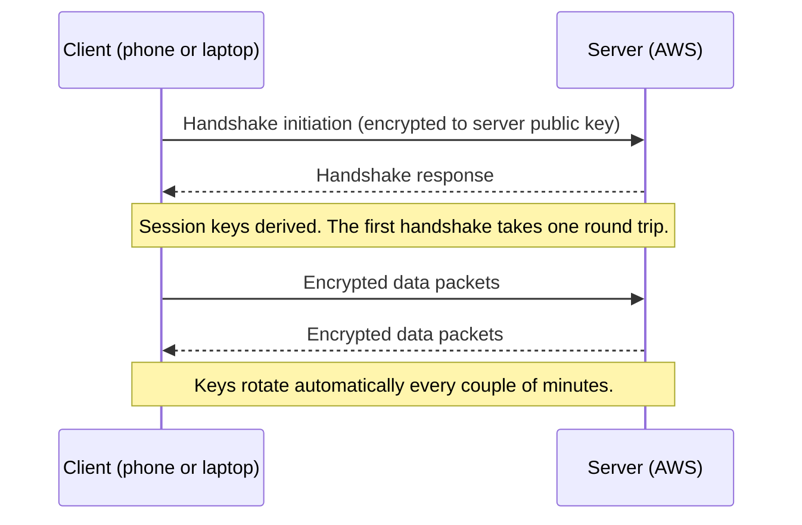
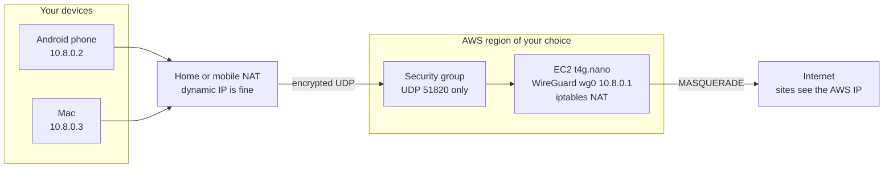
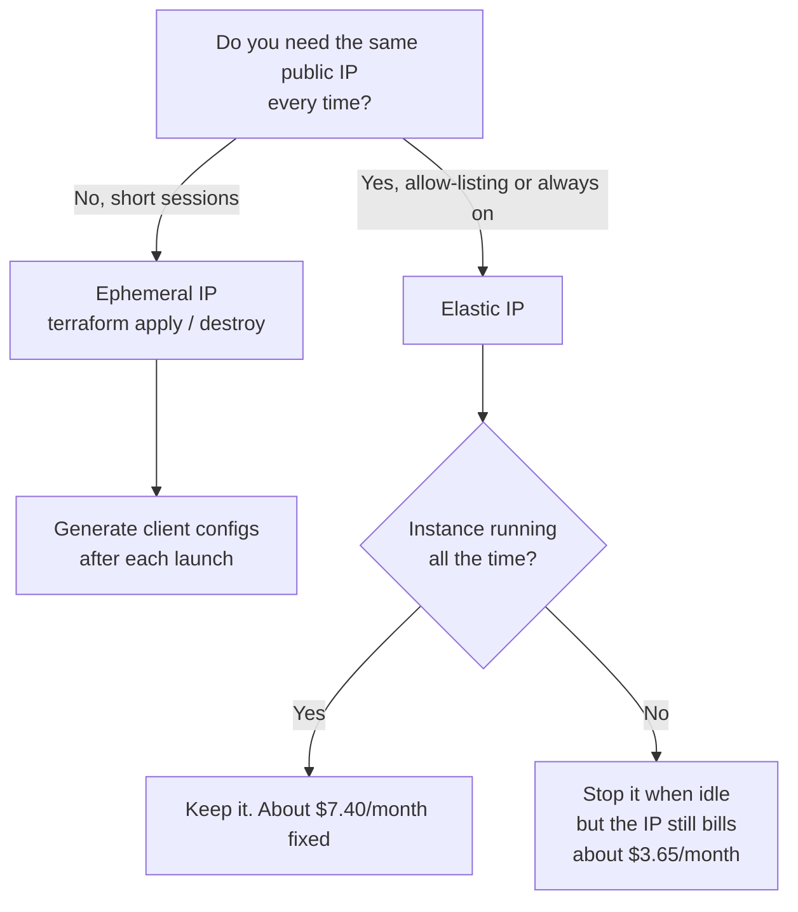
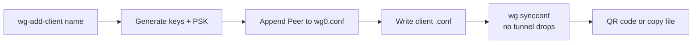
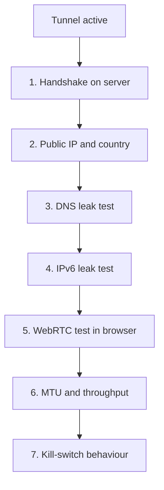
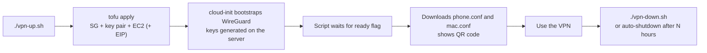

Sometimes you need an IP address in another country for an hour, not a subscription for a year.

Maybe you are checking how your app behaves for US visitors, debugging a CDN edge, testing a region-locked sandbox API, or working from a café Wi-Fi you do not trust. A commercial VPN is a poor fit for this: shared IPs, unknown logging, and no control. A tiny server you own, running for exactly as long as you need it, is a much better tool.

In this guide I build that server on AWS with **WireGuard**, run it on the smallest sensible instance, harden it, set up cost alerts, and then collapse the whole thing into a Terraform (or OpenTofu) file so a fresh VPN is one command away and costs roughly **one cent per hour**.

## TL;DR

- WireGuard is a small, fast, modern VPN protocol built into the Linux kernel. Setup is a couple of config files.
- A `t4g.nano` (ARM, 0.5 GiB RAM) is plenty for personal use and costs about **\$3/month** if left on 24/7, plus about **\$3.65/month** for a public IPv4 address (excluding data transfer charges & taxes).
- For on-demand use, **ephemeral IP + `terraform destroy`** is cheapest. Use an **Elastic IP** only if you need a stable address to allow-list.
- Lock it down: one UDP port open, SSH restricted (or removed), IMDSv2 only, least-privilege IAM, MFA, budget and CloudWatch alarms.
- Prices below are on-demand US region figures at the time of writing. Always confirm in the [AWS pricing pages](https://aws.amazon.com/ec2/pricing/on-demand/).

> **Use it responsibly.** Respect the AWS Acceptable Use Policy, the terms of the services you test against, and your local laws. This guide is for development, testing and privacy, not for evading restrictions you have agreed to follow.

## Table of contents

1. [Why a developer wants an on-demand VPN](#why-a-developer-wants-an-on-demand-vpn)
2. [What is WireGuard?](#what-is-wireguard)
3. [WireGuard vs traditional VPNs](#wireguard-vs-traditional-vpns)
4. [Architecture overview](#architecture-overview)
5. [Choosing the region and the smallest instance](#choosing-the-region-and-the-smallest-instance)
6. [Ephemeral vs static IP](#ephemeral-vs-static-ip)
7. [Step-by-step setup](#step-by-step-setup)
8. [Adding more devices](#adding-more-devices)
9. [Post-setup tests: IP, DNS leak, IPv6, MTU, speed](#post-setup-tests-ip-dns-leak-ipv6-mtu-speed)
10. [Budgets, usage alerts and alarms](#budgets-usage-alerts-and-alarms)
11. [Hardening: firewall, SSH, IAM and best practices](#hardening-firewall-ssh-iam-and-best-practices)
12. [Spin it up on demand with Terraform or OpenTofu](#spin-it-up-on-demand-with-terraform-or-opentofu)
13. [Troubleshooting](#troubleshooting)
14. [FAQ](#faq)

## Why a developer wants an on-demand VPN

| Use case | Why it helps |
|---|---|
| Geo-testing your own product | See pricing, consent banners, redirects and language handling exactly as a visitor in that country would |
| CDN and edge debugging | Check which edge location answers, cache behaviour, and latency from a specific region |
| Region-restricted APIs and sandboxes | Reach services that only accept traffic from one country or cloud range |
| Fixed source IP for allow-lists | Give a client, database or SaaS one stable IP to trust (needs an Elastic IP) |
| Untrusted networks | Encrypt traffic on hotel, airport and café Wi-Fi |
| Experiments | Port-forward a service on your laptop through a public IP, test NAT traversal, try new protocols |
| Disposable infrastructure | Practice infrastructure-as-code with something small that is genuinely useful |

One honest limitation: AWS addresses are datacenter IPs. Some websites treat them differently from residential connections. For development and testing that is usually fine, and even useful, but do not expect it to behave like a home ISP address.

## What is WireGuard?

WireGuard is an open-source VPN protocol and implementation designed to be simple, fast and hard to misuse. It has been part of the mainline Linux kernel since version 5.6 (2020), and there are official apps for Android, iOS, macOS and Windows.

Its main ideas are:

- **Public keys are identities.** Each peer has a private/public key pair. You authorise a peer by adding its public key. There are no certificate authorities, user databases or password prompts.
- **Cryptokey routing.** Every peer has an `AllowedIPs` list. It acts as both a routing table (which traffic goes to this peer) and an access control list (which source addresses are accepted from it).
- **Fixed, modern cryptography.** It uses the Noise protocol framework with Curve25519, ChaCha20-Poly1305, BLAKE2s and HKDF. There is no cipher negotiation, so there is no downgrade attack to worry about.
- **UDP only, and quiet.** It does not answer packets from unauthenticated senders, so a port scan sees nothing.
- **Roaming built in.** If your phone moves from Wi-Fi to mobile data, the server updates the peer's endpoint as soon as it gets a valid packet.
- **Tiny codebase.** The Linux kernel implementation is on the order of a few thousand lines of code, which is easier to audit than traditional VPN stacks.



## WireGuard vs traditional VPNs

| | WireGuard | OpenVPN | IPsec (IKEv2) |
|---|---|---|---|
| Codebase | Very small, in the kernel | Large, plus the OpenSSL library | Large, spread across kernel and daemons |
| Configuration | A few lines per peer | Many options, certificates | Many options, complex policies |
| Identity | Public keys | Certificates or passwords | Certificates, PSKs |
| Crypto | One fixed modern suite | Negotiated, configurable | Negotiated, many suites |
| Transport | UDP | UDP or TCP | UDP (ports 500 and 4500) plus ESP |
| Roaming | Seamless | Reconnect needed | MOBIKE helps |
| Idle behaviour | Sends nothing when idle | Keeps a session open | Keeps SAs |
| Performance | Typically the best of the three, especially on small CPUs | Usually slower, user-space | Good, kernel-based |

What this means in practice for a throwaway server:

- **Fewer moving parts.** There are no certificates to generate, no PKI to maintain, no daemon to babysit. The whole server config fits on one screen.
- **Works on tiny instances.** It is light on CPU and memory, which is what lets us use the cheapest EC2 size.
- **Fast reconnects.** Handy on phones where networks change constantly.
- **Trade-offs:** WireGuard is UDP-only (a few restrictive networks block it, and you may need to move to UDP 443), and it does not assign dynamic IPs or push settings the way a full enterprise VPN does. Every peer is configured explicitly. For a personal VPN that is a feature.

## Architecture overview



Your devices always dial out to the server, so it does not matter that your home ISP gives you a changing, NAT'd IP. Only the **server** needs a public address.

Everything you send is encrypted to the server, then the server forwards it to the internet with its own IP. Websites see the AWS address, in the region you picked.

## Choosing the region and the smallest instance

### Region

The region decides your apparent location, so pick the one that matches your use case. If you just want a cheap US exit, **us-east-1 (N. Virginia)** and **us-east-2 (Ohio)** are among the lowest-priced regions. Prices vary by region, and some regions (São Paulo, for example) cost noticeably more.

Latency matters because every packet takes a detour. From India to US East expect roughly 250 ms round trip. That is fine for browsing and API testing, and noticeable for anything interactive. If you only need an exit for testing, pick the closest region that satisfies your requirement.

### Instance size

A VPN server is bound by network and a little CPU for encryption, not memory. WireGuard in the kernel with NAT needs very little.

| Instance | vCPU | RAM | Approx. on-demand price (us-east-1) | Notes |
|---|---|---|---|---|
| **t4g.nano** | 2 (Graviton, ARM) | 0.5 GiB | about $0.0042/hr, about $3.07/mo | Cheapest sensible choice. ARM, so use an arm64 AMI |
| t3.nano | 2 (x86) | 0.5 GiB | about $0.0052/hr | Pick this only if you need x86 |
| t4g.micro | 2 (ARM) | 1 GiB | about $0.0084/hr | If you also run extra tools on it |
| t3.micro | 2 (x86) | 1 GiB | about $0.0104/hr | x86 equivalent |

My recommendation: **start with `t4g.nano`**. It runs Ubuntu 24.04 comfortably with WireGuard, vnStat and unattended upgrades. Smaller burstable instances have network baseline limits and CPU credits, so a very heavy sustained transfer can throttle. If you consistently need more throughput, move to `t4g.micro` or `t4g.small` before reaching for anything bigger. Check the current network baseline for your type in the [EC2 instance type docs](https://docs.aws.amazon.com/ec2/latest/instancetypes/gp.html).

### The full monthly bill if left on 24/7

| Item | Approx. cost |
|---|---|
| t4g.nano compute | about $3.07 |
| Public IPv4 address (billed hourly since 2024) | about $3.65 |
| 8 GiB gp3 volume | about $0.64 |
| **Fixed total** | **about $7.40** |
| Outbound data | about $0.09 per GB (inbound is free) |

Free tiers exist, but I ignore them here so the numbers hold for any account.

Because everything you download through the VPN leaves the server toward you, **your download volume is your data cost**. Watching 50 GB of video through it costs roughly $4.50 in transfer.

## Ephemeral vs static IP

Every public IPv4 address on AWS is billed per hour while attached, whether auto-assigned or Elastic. What differs is **how long you keep it**.

| | Ephemeral (auto-assigned) | Static (Elastic IP) |
|---|---|---|
| Keeps its address across stop/start | No | Yes |
| Cost while the instance is stopped | $0 | About $0.005/hr still billed |
| Cost if you terminate and forget it | $0 | Still billed until you release it |
| Clients need updating after a new launch | Yes (new endpoint) | No |
| Good for | Short, on-demand sessions | Allow-listing, always-on, shared with others |



My rule of thumb:

- **Experiments and one-off geo tests:** ephemeral. Create it, use it for an hour, destroy it. That is roughly a cent per hour.
- **A stable address other systems must trust:** Elastic IP, and accept the $3.65/month.
- If you want ephemeral cost but stable client configs, put a DNS name in front: set `Endpoint = vpn.example.com:51820` in the clients and update the record after each launch. WireGuard resolves the name when the tunnel starts, so a restart picks up the new address.

## Step-by-step setup

This is the manual path. It is worth doing once so you understand what the Terraform file later automates.

### 1. Prerequisites

- An AWS account with MFA on the root user and a budget alert (see [Budgets](#budgets-usage-alerts-and-alarms)).
- A terminal with SSH (macOS, Linux, or WSL).
- The WireGuard app on your devices: Google Play for Android, the Mac App Store for macOS.

### 2. Launch the instance

In the EC2 console, in your chosen region:

1. **Name:** `wireguard-vpn`.
2. **AMI:** Ubuntu Server 24.04 LTS, architecture **64-bit (Arm)**.
3. **Instance type:** `t4g.nano`.
4. **Key pair:** create an ED25519 key pair, download the `.pem`, and keep it safe.
5. **Network settings:** create a security group with two inbound rules:
   - SSH, TCP 22, source **My IP**
   - Custom UDP, port **51820**, source `0.0.0.0/0`
6. **Storage:** 8 GiB gp3.
7. **Advanced details:** set **Metadata version** to **V2 only (token required)**.
8. Launch.

> Your home IP is dynamic, so the SSH rule will stop matching after your ISP changes it. Edit the rule to refresh it. This is one reason to automate everything later.

### 3. Optional: attach a static IP

If you need one, go to **EC2 > Elastic IPs > Allocate**, then **Associate** it with the instance. The rest of this guide calls it `YOUR_SERVER_IP`. If you skip this step, use the instance's current public IPv4 and expect it to change next time.

### 4. Connect

```bash
chmod 400 ~/.ssh/wg-key.pem
ssh -i ~/.ssh/wg-key.pem ubuntu@YOUR_SERVER_IP
```

### 5. Install and enable forwarding

```bash
sudo apt update && sudo apt -y upgrade
sudo apt -y install wireguard qrencode vnstat
echo 'net.ipv4.ip_forward=1' | sudo tee /etc/sysctl.d/99-wg.conf
sudo sysctl --system
sudo -i
ip route show default      # note the interface name, usually ens5
```

### 6. Generate keys and write the configs

Still as root. Set your server address and interface, then run the block:

```bash
export SERVER_IP=YOUR_SERVER_IP
export IFACE=ens5

mkdir -p /etc/wireguard/clients && cd /etc/wireguard
umask 077
wg genkey | tee server.key | wg pubkey > server.pub
for c in phone mac; do
  wg genkey | tee clients/$c.key | wg pubkey > clients/$c.pub
  wg genpsk > clients/$c.psk
done

cat > wg0.conf <<EOF
[Interface]
Address = 10.8.0.1/24
ListenPort = 51820
PrivateKey = $(cat server.key)
PostUp = iptables -A FORWARD -i wg0 -j ACCEPT; iptables -A FORWARD -o wg0 -j ACCEPT; iptables -t nat -A POSTROUTING -o $IFACE -j MASQUERADE
PostDown = iptables -D FORWARD -i wg0 -j ACCEPT; iptables -D FORWARD -o wg0 -j ACCEPT; iptables -t nat -D POSTROUTING -o $IFACE -j MASQUERADE

[Peer]
# phone
PublicKey = $(cat clients/phone.pub)
PresharedKey = $(cat clients/phone.psk)
AllowedIPs = 10.8.0.2/32

[Peer]
# mac
PublicKey = $(cat clients/mac.pub)
PresharedKey = $(cat clients/mac.psk)
AllowedIPs = 10.8.0.3/32
EOF

i=2
for c in phone mac; do
cat > clients/$c.conf <<EOF
[Interface]
PrivateKey = $(cat clients/$c.key)
Address = 10.8.0.$i/32
DNS = 1.1.1.1, 1.0.0.1
MTU = 1380

[Peer]
PublicKey = $(cat server.pub)
PresharedKey = $(cat clients/$c.psk)
Endpoint = $SERVER_IP:51820
AllowedIPs = 0.0.0.0/0, ::/0
PersistentKeepalive = 25
EOF
i=$((i+1))
done
```

What the important lines do:

- `AllowedIPs = 10.8.0.2/32` on the server pins each peer to one address, so a device cannot impersonate another.
- `AllowedIPs = 0.0.0.0/0, ::/0` on the client sends all traffic through the tunnel. The `::/0` part also stops IPv6 from bypassing it.
- `PersistentKeepalive = 25` keeps the NAT mapping on your home or mobile network alive.
- `PresharedKey` adds a symmetric layer on top of the key exchange, as extra defence-in-depth.
- `MTU = 1380` avoids stalls on some mobile networks. Raise it later if you want.

### 7. Start the VPN

```bash
systemctl enable --now wg-quick@wg0
wg show
```

### 8. Connect Android

1. Install **WireGuard** from the Play Store.
2. On the server, show the QR code: `qrencode -t ansiutf8 < /etc/wireguard/clients/phone.conf`
3. In the app tap **+**, **Scan from QR code**, then toggle the tunnel on.

### 9. Connect your Mac

On the Mac (a new terminal, not the SSH session):

```bash
ssh -i ~/.ssh/wg-key.pem ubuntu@YOUR_SERVER_IP \
  'sudo cat /etc/wireguard/clients/mac.conf' > ~/Downloads/aws-vpn.conf
```

Import it in the WireGuard app (**Import tunnel(s) from file**), activate it, then delete the file:

```bash
rm ~/Downloads/aws-vpn.conf
```

## Adding more devices

A tiny helper makes new devices a one-liner. Create it on the server:

```bash
sudo tee /usr/local/bin/wg-add-client >/dev/null <<'SCRIPT'
#!/bin/bash
# Usage: sudo wg-add-client <name>
set -eo pipefail
NAME="$1"
[ -n "$NAME" ] || { echo "Usage: wg-add-client <name>" >&2; exit 1; }
SERVER_IP=YOUR_SERVER_IP
PORT=51820
WG=/etc/wireguard
umask 077

[ -e "$WG/clients/$NAME.conf" ] && { echo "$NAME already exists" >&2; exit 1; }

LAST=$(grep -h '^AllowedIPs' "$WG/wg0.conf" | sed -E 's/.*\.([0-9]+)\/32.*/\1/' | sort -n | tail -1 || true)
NEXT=$(( ${LAST:-1} + 1 ))

wg genkey | tee "$WG/clients/$NAME.key" | wg pubkey > "$WG/clients/$NAME.pub"
wg genpsk > "$WG/clients/$NAME.psk"

cat >> "$WG/wg0.conf" <<EOF

[Peer]
# $NAME
PublicKey = $(cat "$WG/clients/$NAME.pub")
PresharedKey = $(cat "$WG/clients/$NAME.psk")
AllowedIPs = 10.8.0.$NEXT/32
EOF

cat > "$WG/clients/$NAME.conf" <<EOF
[Interface]
PrivateKey = $(cat "$WG/clients/$NAME.key")
Address = 10.8.0.$NEXT/32
DNS = 1.1.1.1, 1.0.0.1
MTU = 1380

[Peer]
PublicKey = $(cat "$WG/server.pub")
PresharedKey = $(cat "$WG/clients/$NAME.psk")
Endpoint = $SERVER_IP:$PORT
AllowedIPs = 0.0.0.0/0, ::/0
PersistentKeepalive = 25
EOF

wg syncconf wg0 <(wg-quick strip wg0)
echo "Added $NAME as 10.8.0.$NEXT"
[ -t 1 ] && qrencode -t ansiutf8 < "$WG/clients/$NAME.conf"
SCRIPT
sudo chmod 700 /usr/local/bin/wg-add-client
sudo wg-add-client test-tablet
```

`wg syncconf` applies the new peer **without** dropping the existing tunnels.

To revoke a device, delete its `[Peer]` block from `/etc/wireguard/wg0.conf` and run the same `wg syncconf wg0 <(wg-quick strip wg0)` command. Access ends immediately.



## Post-setup tests: IP, DNS leak, IPv6, MTU, speed

A VPN that connects is not necessarily a VPN that protects. Run these checks with the tunnel **on**.



### 1. Confirm the handshake

On the server:

```bash
sudo wg show
```

You want a recent `latest handshake` and non-zero `transfer` for the peer.

### 2. Check your public IP and location

```bash
curl -s https://ipinfo.io
```

The `ip` should be your server's address and `country` the region you chose (for example `US`). Compare with the result with the VPN off.

### 3. DNS leak test

A DNS leak means your lookups still go to your ISP's resolver even though your traffic is tunnelled.

- Open a leak test site (for example dnsleaktest.com or browserleaks.com/dns) and run the **extended** test. You should see only the resolver you set (Cloudflare here), not your ISP.
- From the terminal, this asks OpenDNS what source address it sees. It should print your **server's** IP:

```bash
dig +short myip.opendns.com @resolver1.opendns.com
```

- On macOS, inspect the active resolvers:

```bash
scutil --dns | grep -E 'nameserver|resolver #' | head -20
```

If your ISP's resolver appears, make sure the client config has a `DNS =` line and that no other network service overrides it.

### 4. IPv6 leak test

Our server does not route IPv6, and the client uses `::/0`, so IPv6 traffic is sent into the tunnel and dropped rather than leaking. Verify:

```bash
curl -6 --max-time 5 https://ifconfig.co
```

This should fail or time out. If it returns an address, IPv6 is bypassing the tunnel. Check `AllowedIPs` includes `::/0`.

### 5. WebRTC test

Browsers can reveal local and public IPs through WebRTC. Visit browserleaks.com/webrtc with the VPN on. Your real home IP should not appear.

### 6. MTU and throughput

Find the largest packet that crosses the tunnel without fragmenting (macOS uses `-D`, Linux uses `-M do`):

```bash
ping -D -s 1352 10.8.0.1        # macOS
ping -M do -s 1352 10.8.0.1     # Linux
```

If it fails, lower `MTU` in the client config. For raw speed over the tunnel, run iperf3 against the server's VPN address. No extra security group rule is needed because the test travels inside WireGuard:

```bash
# on the server
sudo apt -y install iperf3 && iperf3 -s
# on the client
iperf3 -c 10.8.0.1
```

Stop the iperf3 server afterwards.

### 7. Kill-switch behaviour

If the tunnel drops, does your traffic leak out in the clear?

- **Android:** open **Settings > Network & internet > VPN > WireGuard** and enable **Always-on VPN** and **Block connections without VPN**.
- **macOS:** the official app has no built-in kill switch. Be aware of this for sensitive work, and consider a firewall tool if you need one.

## Budgets, usage alerts and alarms

A forgotten server is the main way this hobby gets expensive. Set up three layers.

### 1. Monthly cost budget

1. In the console open **Billing and Cost Management > Budgets > Create budget**.
2. Choose **Use a template (simplified)** and **Monthly cost budget**.
3. Set the amount (I use $15), enter your email, and create it.

The template emails you at 85% of actual spend and at 100% actual and forecasted. Add an extra 50% alert if you want early warning.

### 2. Data-transfer alarm in CloudWatch

Budgets lag by several hours. For a faster signal on runaway traffic, alarm on outbound bytes:

1. **CloudWatch > Alarms > Create alarm > Select metric > EC2 > Per-Instance Metrics > NetworkOut**.
2. Statistic **Sum**, period **1 day**, condition **greater than** `5000000000` (about 5 GB per day, adjust to taste).
3. Create a new SNS topic with your email and **confirm the subscription email**. Alerts do not arrive until you click that link.

### 3. Instance health alarm

Create another alarm on `StatusCheckFailed` (maximum, 5 minutes, greater than or equal to 1) and send it to the same topic.

### 4. Cost Anomaly Detection

**Billing > Cost Anomaly Detection** is free and flags unusual spend patterns that a fixed threshold misses.

### 5. Check from inside the server

```bash
systemctl enable --now vnstat
vnstat -m -i ens5      # monthly totals; tx is what AWS bills
vnstat -l -i ens5      # live view
```

On a fresh install vnStat prints "No data" until it has collected a few minutes of traffic. That is normal.

### 6. The best safety net: auto-shutdown

For on-demand sessions, let the server destroy itself. Schedule a shutdown at boot and tell EC2 to terminate on shutdown:

```bash
sudo shutdown -P +480      # power off in 8 hours
```

The Terraform section below sets `instance_initiated_shutdown_behavior = "terminate"` so the instance disappears instead of lingering stopped.

## Hardening: firewall, SSH, IAM and best practices

### Network: two layers of firewall

**Security group (AWS-level, stateful):**

| Direction | Rule | Why |
|---|---|---|
| Inbound | UDP 51820 from `0.0.0.0/0` | Required, because your client IP changes. WireGuard ignores unauthenticated packets |
| Inbound | TCP 22 from your `/32` only, or none | Never expose SSH to the world |
| Inbound | Nothing else | Add ports only for deliberate port forwards, and restrict their source |
| Outbound | All | The VPN needs it to reach the internet |

**Host firewall (UFW, defence in depth).** Keep your current SSH session open while you do this, and test from a second terminal before closing it:

```bash
sudo ufw default deny incoming
sudo ufw default allow outgoing
sudo ufw allow 51820/udp
sudo ufw allow from YOUR_HOME_IP to any port 22 proto tcp
sudo ufw route allow in on wg0 out on ens5
sudo ufw enable
sudo ufw status verbose
```

The `route allow` line permits forwarded VPN traffic. If your home IP changes, update the SSH rule in both the security group and UFW, or use Session Manager below.

### Remove SSH entirely with Session Manager

The strongest SSH hardening is not having SSH. AWS Systems Manager Session Manager gives you a shell over HTTPS, authenticated by IAM, with no inbound port.

1. Attach an instance profile with the managed policy `AmazonSSMManagedInstanceCore`.
2. Make sure outbound HTTPS is allowed (it is by default).
3. Use **EC2 > Connect > Session Manager**, or the AWS CLI with the Session Manager plugin.
4. Delete the port 22 rule.

### Harden the instance itself

- **IMDSv2 only.** Require session tokens for the metadata service so a server-side request forgery bug cannot easily steal credentials. In the launch settings choose **Metadata version: V2 only**, or in Terraform `http_tokens = "required"`.
- **No credentials on the box.** Do not attach powerful IAM roles to the VPN server. It does not need AWS access.
- **SSH settings** (if you keep SSH): key-only, no root. Verify with `sudo sshd -T | grep -Ei 'passwordauthentication|permitrootlogin'`.
- **Automatic security updates:**

```bash
sudo apt -y install unattended-upgrades
cat /etc/apt/apt.conf.d/20auto-upgrades
```

  Check for pending reboots occasionally with `[ -f /var/run/reboot-required ] && echo reboot`.
- **Encrypt the volume.** Cheap and one checkbox (`encrypted = true` in Terraform).
- **Do not log traffic.** WireGuard keeps no connection logs. Leave VPC Flow Logs off unless you need them, and remember CloudTrail records your AWS API calls.

### WireGuard best practices

- One key pair **per device**, never shared. If a phone is lost, revoke only that peer.
- Keep `AllowedIPs` on the server at `/32` per peer.
- Use a preshared key per peer.
- Treat client `.conf` files as passwords. Delete downloaded copies after importing, and never commit them to Git.
- Restrict `chmod 600` on `wg0.conf` and key files, and `chmod 700` on `/etc/wireguard`.
- Rotate keys when someone leaves or a device is retired.
- If multiple people share the server, isolate clients from each other with an iptables rule that drops `wg0` to `wg0` forwarding.

### IAM and account hygiene

1. **Lock the root user.** Enable MFA, create no access keys, and stop using it day to day.
2. **Use a separate IAM identity for operating the VPN.** Here is a policy that can start, stop and reboot the VPN instance, adjust its security group, and open a browser SSH session, but cannot terminate anything or see billing. It only applies to resources tagged `Project=wireguard-vpn` in one region:

```json
{
  "Version": "2012-10-17",
  "Statement": [
    {
      "Sid": "ReadOnlyForConsole",
      "Effect": "Allow",
      "Action": ["ec2:Describe*", "cloudwatch:DescribeAlarms", "cloudwatch:GetMetricData", "cloudwatch:GetMetricStatistics", "cloudwatch:ListMetrics"],
      "Resource": "*"
    },
    {
      "Sid": "StartStopReboot",
      "Effect": "Allow",
      "Action": ["ec2:StartInstances", "ec2:StopInstances", "ec2:RebootInstances"],
      "Resource": "arn:aws:ec2:us-east-2:*:instance/*",
      "Condition": { "StringEquals": { "aws:ResourceTag/Project": "wireguard-vpn" } }
    },
    {
      "Sid": "EditSecurityGroupRules",
      "Effect": "Allow",
      "Action": ["ec2:AuthorizeSecurityGroupIngress", "ec2:RevokeSecurityGroupIngress", "ec2:ModifySecurityGroupRules", "ec2:UpdateSecurityGroupRuleDescriptionsIngress"],
      "Resource": "arn:aws:ec2:us-east-2:*:security-group/*",
      "Condition": { "StringEquals": { "aws:ResourceTag/Project": "wireguard-vpn" } }
    }
  ]
}
```

3. **Enable MFA on every IAM user** that has console access.
4. **For Terraform, use a dedicated identity**, ideally short-lived credentials via IAM Identity Center (`aws sso login`) instead of long-lived access keys. At minimum, scope the policy to one region with the `aws:RequestedRegion` condition and to the EC2 actions you need.
5. **Tag everything** with `Project` so policies, budgets and clean-ups can target your resources.
6. **Review periodically:** delete unused access keys and users, and look at CloudTrail event history for anything unexpected.

## Spin it up on demand with Terraform or OpenTofu

Now we turn all of that into code. The result: `./vpn-up.sh` builds the server, waits for it, downloads your configs and prints a QR code. `./vpn-down.sh` deletes everything.



Keys are generated **on the server**, so private keys never end up in the Terraform state file.

### Project layout

```text
wg-vpn/
├── main.tf
├── wg-bootstrap.sh.tftpl
├── vpn-up.sh
└── vpn-down.sh
```

### `main.tf`

```hcl
terraform {
  required_version = ">= 1.6.0"
  required_providers {
    aws  = { source = "hashicorp/aws", version = ">= 5.40, < 7.0" }
    http = { source = "hashicorp/http", version = "~> 3.4" }
  }
}

variable "region"              { default = "us-east-2" }
variable "name"                { default = "wireguard-vpn" }
variable "instance_type"       { default = "t4g.nano" }
variable "wg_port"             { default = 51820 }
variable "static_ip"           { default = false }   # true = Elastic IP
variable "ssh_public_key_path" { default = "~/.ssh/wg-key.pub" }
variable "ssh_cidr"            { default = "" }      # empty = auto-detect my IPv4
variable "auto_shutdown_hours" { default = 8 }       # 0 = never
variable "clients"             { default = ["phone", "mac"] }

provider "aws" {
  region = var.region
  default_tags {
    tags = { Project = var.name, ManagedBy = "terraform" }
  }
}

data "aws_vpc" "default" { default = true }

data "aws_ami" "ubuntu" {
  most_recent = true
  owners      = ["099720109477"] # Canonical
  filter {
    name   = "name"
    values = ["ubuntu/images/hvm-ssd-gp3/ubuntu-noble-24.04-arm64-server-*"]
  }
}

data "http" "my_ip" {
  count = var.ssh_cidr == "" ? 1 : 0
  url   = "https://ipv4.icanhazip.com"
}

locals {
  ssh_cidr = var.ssh_cidr != "" ? var.ssh_cidr : "${chomp(data.http.my_ip[0].response_body)}/32"
}

resource "aws_key_pair" "vpn" {
  key_name   = "${var.name}-key"
  public_key = file(pathexpand(var.ssh_public_key_path))
}

resource "aws_security_group" "vpn" {
  name        = "${var.name}-sg"
  description = "WireGuard VPN"
  vpc_id      = data.aws_vpc.default.id

  ingress {
    description = "WireGuard"
    from_port   = var.wg_port
    to_port     = var.wg_port
    protocol    = "udp"
    cidr_blocks = ["0.0.0.0/0"]
  }
  ingress {
    description = "SSH from my IP"
    from_port   = 22
    to_port     = 22
    protocol    = "tcp"
    cidr_blocks = [local.ssh_cidr]
  }
  egress {
    from_port   = 0
    to_port     = 0
    protocol    = "-1"
    cidr_blocks = ["0.0.0.0/0"]
  }
}

resource "aws_eip" "vpn" {
  count  = var.static_ip ? 1 : 0
  domain = "vpc"
}

resource "aws_instance" "vpn" {
  ami                         = data.aws_ami.ubuntu.id
  instance_type               = var.instance_type
  key_name                    = aws_key_pair.vpn.key_name
  vpc_security_group_ids      = [aws_security_group.vpn.id]
  associate_public_ip_address = true

  # Shutting the OS down terminates the instance, so a forgotten VPN deletes itself
  instance_initiated_shutdown_behavior = "terminate"

  user_data = templatefile("${path.module}/wg-bootstrap.sh.tftpl", {
    wg_port          = var.wg_port
    static_ip        = try(aws_eip.vpn[0].public_ip, "")
    clients          = join(" ", var.clients)
    shutdown_minutes = var.auto_shutdown_hours * 60
  })

  metadata_options {
    http_tokens   = "required" # IMDSv2 only
    http_endpoint = "enabled"
  }

  root_block_device {
    volume_type           = "gp3"
    volume_size           = 8
    encrypted             = true
    delete_on_termination = true
  }

  tags = { Name = var.name }
}

resource "aws_eip_association" "vpn" {
  count         = var.static_ip ? 1 : 0
  instance_id   = aws_instance.vpn.id
  allocation_id = aws_eip.vpn[0].id
}

output "public_ip" {
  value = coalesce(one(aws_eip.vpn[*].public_ip), aws_instance.vpn.public_ip)
}
```

### `wg-bootstrap.sh.tftpl`

This runs once as root on first boot. Terraform fills in the `${...}` values.

```bash
#!/bin/bash
set -euxo pipefail
exec > >(tee -a /var/log/wg-setup.log) 2>&1
export DEBIAN_FRONTEND=noninteractive

# Work out the address clients should connect to
ENDPOINT_IP="${static_ip}"
if [ -z "$ENDPOINT_IP" ]; then
  TOKEN=$(curl -s -X PUT http://169.254.169.254/latest/api/token -H "X-aws-ec2-metadata-token-ttl-seconds: 300")
  ENDPOINT_IP=$(curl -s -H "X-aws-ec2-metadata-token: $TOKEN" http://169.254.169.254/latest/meta-data/public-ipv4)
else
  # Wait until the Elastic IP is attached so apt does not break mid-download
  for i in $(seq 1 60); do
    [ "$(curl -4 -s --max-time 5 https://checkip.amazonaws.com || true)" = "$ENDPOINT_IP" ] && break
    sleep 5
  done
fi

apt-get -o Acquire::Retries=5 update
apt-get -o Acquire::Retries=5 -y install wireguard qrencode vnstat unattended-upgrades iptables

echo 'net.ipv4.ip_forward=1' > /etc/sysctl.d/99-wg.conf
sysctl --system

IFACE=$(ip route show default | awk '{print $5; exit}')
umask 077
mkdir -p /etc/wireguard/clients
cd /etc/wireguard
wg genkey | tee server.key | wg pubkey > server.pub

cat > wg0.conf <<EOF
[Interface]
Address = 10.8.0.1/24
ListenPort = ${wg_port}
PrivateKey = $(cat server.key)
PostUp = iptables -A FORWARD -i wg0 -j ACCEPT; iptables -A FORWARD -o wg0 -j ACCEPT; iptables -t nat -A POSTROUTING -o $IFACE -j MASQUERADE
PostDown = iptables -D FORWARD -i wg0 -j ACCEPT; iptables -D FORWARD -o wg0 -j ACCEPT; iptables -t nat -D POSTROUTING -o $IFACE -j MASQUERADE
EOF

i=2
for c in ${clients}; do
  wg genkey | tee clients/$c.key | wg pubkey > clients/$c.pub
  wg genpsk > clients/$c.psk

  cat >> wg0.conf <<EOF

[Peer]
# $c
PublicKey = $(cat clients/$c.pub)
PresharedKey = $(cat clients/$c.psk)
AllowedIPs = 10.8.0.$i/32
EOF

  cat > clients/$c.conf <<EOF
[Interface]
PrivateKey = $(cat clients/$c.key)
Address = 10.8.0.$i/32
DNS = 1.1.1.1, 1.0.0.1
MTU = 1380

[Peer]
PublicKey = $(cat server.pub)
PresharedKey = $(cat clients/$c.psk)
Endpoint = $ENDPOINT_IP:${wg_port}
AllowedIPs = 0.0.0.0/0, ::/0
PersistentKeepalive = 25
EOF
  i=$((i+1))
done

systemctl enable --now wg-quick@wg0
systemctl enable --now vnstat || true

cat > /etc/apt/apt.conf.d/20auto-upgrades <<EOF
APT::Periodic::Update-Package-Lists "1";
APT::Periodic::Unattended-Upgrade "1";
EOF

touch /var/lib/wg-setup-done

# Dead-man switch: power off (and therefore terminate) after N minutes
if [ "${shutdown_minutes}" -gt 0 ]; then
  shutdown -P +${shutdown_minutes}
fi
```

### `vpn-up.sh` and `vpn-down.sh`

```bash
#!/usr/bin/env bash
# vpn-up.sh
set -euo pipefail
cd "$(dirname "$0")"

tofu apply -auto-approve "$@"      # use `terraform` if you prefer
IP=$(tofu output -raw public_ip)
KEY=~/.ssh/wg-key
SSH=(ssh -i "$KEY" -o StrictHostKeyChecking=no -o UserKnownHostsFile=/dev/null -o LogLevel=ERROR -o ConnectTimeout=5)

echo "Waiting for the server at $IP to finish bootstrapping..."
until "${SSH[@]}" ubuntu@"$IP" 'test -f /var/lib/wg-setup-done' 2>/dev/null; do sleep 5; done

mkdir -p out
for c in phone mac; do
  "${SSH[@]}" ubuntu@"$IP" "sudo cat /etc/wireguard/clients/$c.conf" > "out/$c.conf"
done
chmod 600 out/*.conf

echo
echo "Scan this with the WireGuard app on Android:"
qrencode -t ansiutf8 < out/phone.conf       # brew install qrencode
echo
echo "Mac config saved to out/mac.conf. Import it, then delete it."
```

```bash
#!/usr/bin/env bash
# vpn-down.sh
set -euo pipefail
cd "$(dirname "$0")"
tofu destroy -auto-approve
rm -rf out
```

Make both executable with `chmod +x vpn-up.sh vpn-down.sh`.

A note on the SSH options: disabling host key checking is acceptable for a throwaway server whose address changes every time, but it removes protection against someone intercepting that first connection. If that matters to you, pin the host key from the instance console output instead.

### Usage

```bash
ssh-keygen -t ed25519 -f ~/.ssh/wg-key -N ""
./vpn-up.sh                              # new VPN with a random IP
./vpn-up.sh -var static_ip=true          # same, but with an Elastic IP
./vpn-up.sh -var region=us-west-2        # different exit location
./vpn-down.sh                            # delete everything
```

### What a session costs

| Item | Cost |
|---|---|
| t4g.nano compute | about $0.0042/hr |
| Public IPv4 | about $0.005/hr |
| 8 GiB gp3 (prorated) | under $0.001/hr |
| **Total** | **about $0.01 per hour** |
| Data | about $0.09/GB leaving the server |

A four-hour testing session costs roughly four cents plus data.

### Taking it further

- **Stable client configs.** Store the server private key in AWS Systems Manager Parameter Store (SecureString) and read it at boot, so only the endpoint changes between launches.
- **Fixed DNS name.** Update a DNS record with the new IP after each `apply`, and use the hostname as the client `Endpoint`.
- **Alerts as code.** Add `aws_budgets_budget`, an SNS topic and `aws_cloudwatch_metric_alarm` resources for `NetworkOut` and `StatusCheckFailed`, mirroring the console steps above.
- **Session Manager instead of SSH.** Add an IAM role with `AmazonSSMManagedInstanceCore`, drop the port 22 rule, and fetch configs with Systems Manager.
- **Port forwarding.** Expose a service on your laptop through the server's public IP with DNAT rules over the tunnel. Open only the specific port, restrict the source CIDR, and remember that visitor traffic counts as outbound data.

## Troubleshooting

| Symptom | Likely cause and fix |
|---|---|
| No handshake | Check the security group allows UDP 51820 from `0.0.0.0/0`, the `Endpoint` IP is current, and the public key in `wg0.conf` matches the client |
| Handshake works, no internet | `sysctl net.ipv4.ip_forward` must be `1`; confirm the interface name in `PostUp` with `ip route show default` |
| Some pages stall | Lower client `MTU` to `1280` |
| Works on Wi-Fi but not mobile data | The network may block UDP 51820. Move to UDP 443 and open that port in the security group |
| Cannot SSH after a while | Your home IP changed. Refresh the SSH rule (re-run `tofu apply` if you auto-detect it) |
| IP shows the wrong country | Tunnel is off, or traffic is split. Check `AllowedIPs = 0.0.0.0/0, ::/0` |
| Android tunnel keeps dropping | Disable battery optimisation for the WireGuard app |
| `vnstat` shows "No data" | Normal right after install. Wait a few minutes and make sure the `vnstat` service is running |

## FAQ

### Is WireGuard faster than OpenVPN?

Usually, yes. It runs inside the Linux kernel, uses a lean modern cipher suite and has a very small codebase, so it does less work per packet, especially on small CPUs like a nano instance. Your real-world speed is still bound by your own link, the distance to the region, and the instance's network baseline.

### What is the cheapest AWS instance for a WireGuard VPN?

`t4g.nano` is the cheapest sensible option: about $0.0042 per hour on-demand in us-east-1, with 2 Graviton vCPUs and 0.5 GiB of RAM. It handles a few personal devices easily. Use an arm64 AMI.

### Is an Elastic IP worth it?

Only if something needs a stable address, such as an allow-list, or if you leave the server running all the time. For short on-demand sessions an auto-assigned IP is cheaper because it disappears with the instance. Remember that AWS bills every public IPv4 address hourly, attached or not.

### Do I need a static IP at home?

No. Your devices connect outward to the server, so your ISP's dynamic, NAT'd IP is irrelevant. Only the server needs a reachable address.

### Can I use this for streaming or to get around restrictions?

I would not rely on it. AWS ranges are widely recognised as datacenter addresses, and services can restrict them. Use the VPN within the rules of AWS and the services you access.

### How do I know my VPN is not leaking?

Run the checks in the testing section: confirm the public IP and country, run an extended DNS leak test, verify IPv6 fails rather than leaks, check WebRTC in your browser, and turn on a kill switch on Android.

### How do I stop all charges?

Run `./vpn-down.sh` (or `terraform destroy`). If you created an Elastic IP by hand, release it too, because an allocated address bills even when nothing is attached. Then check the Billing page the next day.

## Wrapping up

An on-demand WireGuard server is one of those small projects that keeps paying back: a few dozen lines of config, a cent an hour, and an exit point in any AWS region whenever you need one.

The pattern generalises. Disposable infrastructure, defined as code, with cost guardrails and automatic clean-up, is a good default for any experiment, and a personal VPN is a nicely practical place to practise it.

If you build on this, I would love to hear what you use it for.