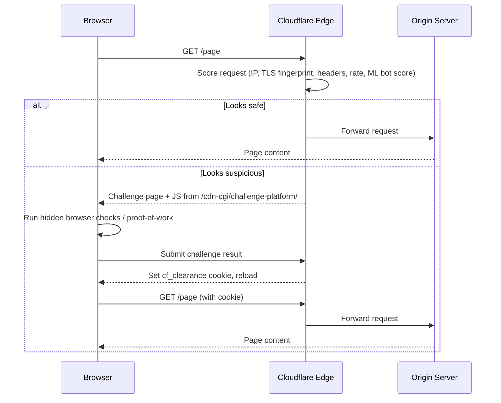
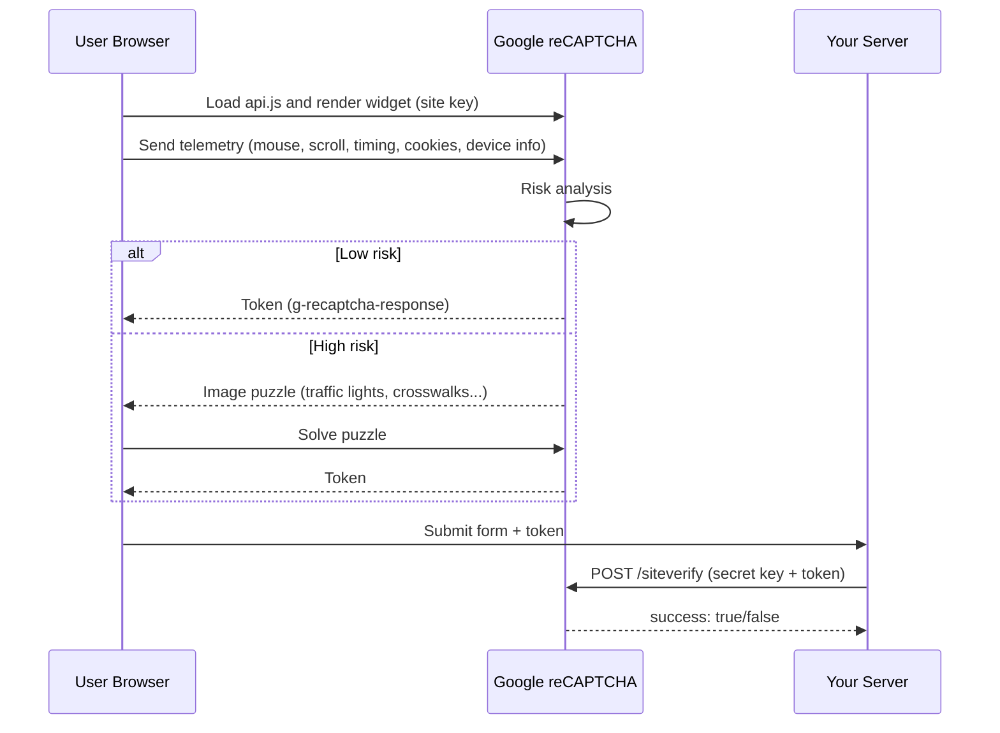
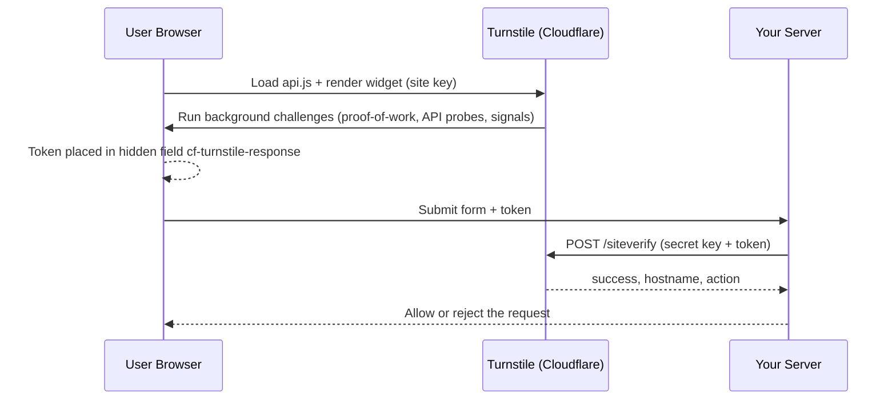
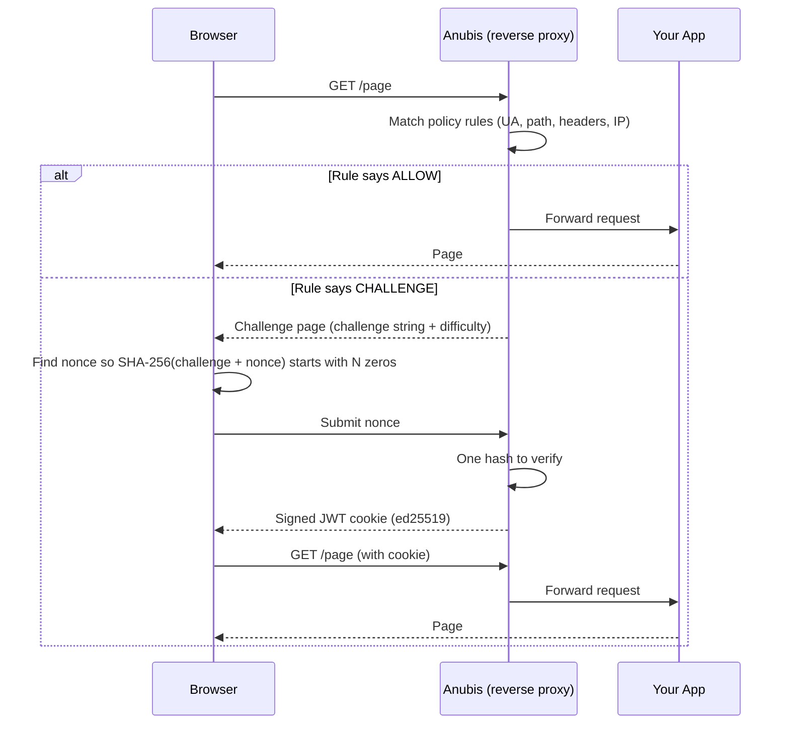
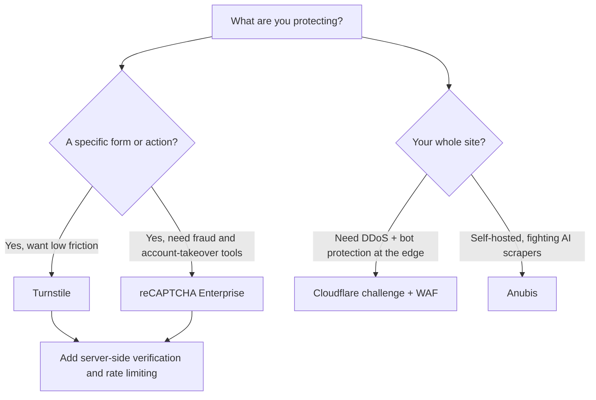

import { Image } from 'astro:assets';

import botVerificationImage from '../../assets/blog/bot-verification-illustration.png';
import cloudflareVerificationImage from '../../assets/blog/cloudflare-verification-illustration.png';
import recaptchaEvolutionImage from '../../assets/blog/recaptch-evolution-illustration.png';
import cloudflareTurnstileImage from '../../assets/blog/cloudflare-turnstile-illustration.png';
import anubisSoulWeighImage from '../../assets/blog/anubis-soul-weigh-illustration.png'

When you click a link and encounter a screen stating "Just a moment..." or "Verify you are human," an automated system has intercepted your request. That interstitial checkpoint is distinct from Google's "I'm not a robot" checkbox, Cloudflare's Turnstile widget, and proof-of-work filters like Anubis.

Each system addresses automated traffic differently through edge evaluation, user behavioral tracking, or computational cost.

## TL;DR

- Cloudflare's verification page gates an entire site, scoring requests at the network edge and running browser checks in JavaScript before issuing a `cf_clearance` cookie.
- Google reCAPTCHA inspects requests at the application level: v2 uses a checkbox with fallback image puzzles, while v3 returns a silent score from 0.0 to 1.0.
- Cloudflare Turnstile replaces traditional CAPTCHAs on specific forms, generating a single-use token verified by your server.
- Anubis is a self-hosted proof-of-work reverse proxy that requires visitors to compute SHA-256 hashes, raising compute costs for high-volume scrapers.
- No single check is unbreakable; each balances identity checks, behavioral analysis, and computational overhead.

## Table of contents

1. [Why websites verify you at all](#why-websites-verify-you-at-all)
2. [The Cloudflare verification page](#the-cloudflare-verification-page-just-a-moment)
3. [Google reCAPTCHA, version by version](#google-recaptcha-version-by-version)
4. [Cloudflare Turnstile](#cloudflare-turnstile-puzzle-free-verification)
5. [Cloudflare vs reCAPTCHA](#cloudflare-vs-recaptcha-head-to-head)
6. [Anubis: proof-of-work for the AI-crawler era](#anubis-proof-of-work-for-the-ai-crawler-era)
7. [Headless browsers and automation evasion](#headless-browsers-and-automation-evasion)
8. [Which one should you use?](#which-one-should-you-use)
9. [FAQ](#faq)

## Why websites verify you at all

Automated traffic accounts for a large portion of all web requests. While search engine crawlers index content constructively, unmanaged bots introduce operational risks:

- Credential stuffing attacks testing compromised passwords against authentication endpoints.
- Automated registration and spam across comment sections, contact forms, and mailing lists.
- Card testing attempts validating stolen payment credentials on checkout flows.
- High-frequency scraping targeting proprietary content, pricing catalogs, and AI training corpora.
- Application-layer DDoS floods that exhaust origin server resources.

Verification tools attempt to isolate and filter out automated traffic without degrading the experience for legitimate users, a task complicated by modern automation frameworks that run real browser engines.

<Image src={botVerificationImage} alt="Cloudflare verification page" style={{ marginBottom: "0.5rem", marginTop: "1rem" }} />

## The Cloudflare verification page ("Just a moment...")

### What it is

The interstitial screen is Cloudflare's challenge platform. Operating as a reverse proxy, Cloudflare routes DNS traffic through its global edge servers before forwarding requests to the origin host.

Based on configured firewall rules, machine-learning bot scores, and active threat levels, the edge decides whether to pass the request directly to the origin, terminate it, or present a challenge page.

### How it works, step by step



1. Edge scoring. Before serving content, the edge analyzes parameters available directly from the TCP and TLS handshakes:
   - IP reputation and autonomous system number (ASN), identifying data-center ranges versus residential connections.
   - TLS fingerprints (JA3/JA4), comparing cipher suites and handshake parameters against known browser profiles.
   - HTTP/2 settings and header ordering, which differ between automated clients and standard browsers.
   - Request rates and historical traffic patterns across Cloudflare's global edge network.
   - A machine-learning bot score calculated from network-wide telemetry.
2. The challenge page. If the request appears suspicious, the edge returns a challenge page that loads an obfuscated script from `/cdn-cgi/challenge-platform/`.
3. Browser probing. The script checks whether an authentic browser environment is running. It inspects automation indicators such as `navigator.webdriver`, canvas and WebGL rendering, execution timing, and browser API quirks. Certain modes append a proof-of-work calculation or accept Private Access Tokens from supported Apple and Google devices.
4. Clearance cookie. Once validated, Cloudflare sets a `cf_clearance` cookie tied to the client's IP and user agent. Subsequent requests bypass the interstitial until the cookie expires.

### Challenge types

| Mode | What you see |
|---|---|
| Managed challenge | Cloudflare automatically selects non-interactive or interactive verification based on risk |
| Non-interactive | A brief spinner without user interaction |
| Interactive | A manual checkbox ("Verify you are human") |

<Image src={cloudflareVerificationImage} alt="Cloudflare verification illustration" style={{ marginBottom: "0.5rem", marginTop: "1rem" }} />

## Google reCAPTCHA, version by version

Google's reCAPTCHA architecture evolved across three major revisions, moving from OCR deciphering to silent behavioral risk scoring.

### reCAPTCHA v1: the distorted words (retired)

The initial version of reCAPTCHA presented two distorted text snippets: a known control word to verify human input, and an unreadable fragment from physical book scans that optical character recognition software failed to parse. As computer vision systems evolved to solve distorted text with high accuracy, Google decommissioned v1 in 2018.

### reCAPTCHA v2: the checkbox ("I'm not a robot")

v2 introduced the interactive checkbox, using user interactions as one component of a broader risk model:



1. The page loads Google's `api.js`, which renders the widget inside iframes hosted on Google domains.
2. While the visitor interacts with the page, the client script gathers telemetry: cursor trajectories, scroll velocity, interaction timing, hardware attributes, IP address, and Google account session cookies.
3. Google evaluates the session risk. Low-risk sessions clear with a single click, while ambiguous sessions trigger an image classification challenge.
4. The client receives a token (`g-recaptcha-response`), which the origin server submits alongside a secret key to Google's `siteverify` endpoint. Unverified tokens provide no protection.

v2 is available as an interactive checkbox, an invisible variant tied to existing button actions, or an Android SDK.

### reCAPTCHA v3: the invisible score

reCAPTCHA v3 eliminates user-facing challenges, running invisibly in the background:

```javascript
grecaptcha.ready(() => {
  grecaptcha.execute("YOUR_SITE_KEY", { action: "login" }).then((token) => {
    // send token to your server with the request
  });
});
```

After your server verifies the token, Google returns a score between 0.0 (likely automated) and 1.0 (likely human), alongside the specified action. Applications use this score to permit the action, trigger two-factor authentication, or reject the request.

Google recommends executing the script across every page to build a session-wide behavioral baseline, though this increases both tracking scope and billable API calls.

### reCAPTCHA Enterprise and Google Cloud

Enterprise provides an assessments API (`projects.assessments.create`), granular risk score reason codes, mobile SDKs, credential-stuffing detection, and WAF integration. Google manages keys inside Google Cloud projects under its Fraud Defense umbrella.

### reCAPTCHA pricing

- The free tier covers up to 10,000 assessments monthly per organization across all registered domains.
- Standard pricing begins around $8 per month for up to 100,000 assessments, followed by roughly $1 per 1,000 subsequent requests.
- A Google Cloud billing account is required for full feature access.

Because page-wide v3 monitoring consumes assessments on every route, high-traffic sites exceed the free threshold quickly.

<Image src={recaptchaEvolutionImage} alt="Recaptcha evolution"  style={{ marginBottom: "0.5rem", marginTop: "1rem" }} />

## Cloudflare Turnstile: puzzle-free verification

### What it is and what problem it solves

Turnstile packages Cloudflare's challenge platform into an embeddable widget for specific forms, including authentication, registration, checkout, and contact endpoints. It operates without requiring Cloudflare DNS or proxying.

While it mitigates credential stuffing, form spam, and automated endpoint abuse without forcing users through image puzzles, it does not mitigate site-wide scraping or DDoS attacks outside the protected forms.

### How it works



Client implementation:

```html
<script src="https://challenges.cloudflare.com/turnstile/v0/api.js" async defer></script>

<form action="/login" method="POST">
  <input name="email" />
  <div class="cf-turnstile" data-sitekey="YOUR_SITE_KEY"></div>
  <button>Log in</button>
</form>
```

The widget runs non-interactive checks in the background, including proof-of-work, browser-API probing, and environment signals, and can use Private Access Tokens. A visible checkbox appears only when needed. Modes are managed, non-interactive, and invisible.

Server-side verification:

The generated client token must be verified by your backend:

```
POST https://challenges.cloudflare.com/turnstile/v0/siteverify
  secret=YOUR_SECRET_KEY
  response=<token from the form>
  remoteip=<optional visitor IP>
```

The reply format:

```json
{ "success": true, "challenge_ts": "...", "hostname": "example.com", "action": "login", "error-codes": [] }
```

Tokens are single-use and expire after roughly five minutes to prevent replay attacks. Server validation should also verify that the `hostname` and `action` match expected values.

### Languages and frameworks

Turnstile requires only a JavaScript client widget and a single HTTPS validation call on the server:

- Frontend implementations support vanilla HTML and JavaScript alongside component libraries for React, Vue, Svelte, Angular, Next.js, and Nuxt.
- Backend handlers can run in any runtime that makes HTTPS requests, including Node.js, Python, Go, PHP, Java, C#, Ruby, Rust, or Cloudflare Workers.
- Pre-built plugins exist for WordPress and common authentication platforms.

<Image src={cloudflareTurnstileImage} alt="Cloudflare turnstile illustration"  style={{ marginBottom: "0.5rem", marginTop: "1rem" }} />

## Cloudflare vs reCAPTCHA: head-to-head

### Technical differences

| Aspect | Google reCAPTCHA | Cloudflare (Turnstile / challenge page) |
|---|---|---|
| Where it runs | Application level. The origin server receives the request and verifies a token | Challenge page runs at the edge, before the origin. Turnstile runs at the application level |
| Primary telemetry | Google cross-site tracking: cookies, authenticated Google sessions, browsing activity | Network telemetry: IP reputation, TLS and HTTP handshakes, request volume across edge nodes |
| Output | v2: pass/fail token. v3/Enterprise: 0.0 to 1.0 continuous score with reason codes | Pass/fail token (Turnstile) or `cf_clearance` cookie (challenge page) |
| User interface | Interactive image classification on high risk | Primarily silent checks; interactive checkbox on elevated risk |
| Data handling | Behavioral profiles and Google session tracking | Browser environment and network fingerprinting without advertising profile association |
| Cloudflare hosting required? | No | No for Turnstile. Yes for edge challenge pages |
| Scope | Protected forms and routes | Whole site via WAF challenge pages, or specific endpoints via Turnstile |

The primary difference lies in visibility. Google evaluates user identity and cross-site browsing history, while Cloudflare evaluates network-layer signals and traffic volume across its edge. Cloudflare can also pair verification with edge-level DDoS mitigation and rate limiting.

### Cost

- reCAPTCHA includes 10,000 free monthly assessments before switching to usage-based pricing.
- Turnstile provides a free tier with unlimited challenges and widget-count limits, with paid enterprise tiers for advanced analytics.

### Strength

- reCAPTCHA v2 image puzzles are routinely bypassed by computer-vision models and low-cost human solving farms.
- reCAPTCHA v3 and Enterprise rely on behavioral scoring, requiring developers to calibrate score thresholds to balance false positives against undetected bots.
- Turnstile and Cloudflare challenge pages reliably intercept automated frameworks and commodity scrapers using network fingerprints, though stealth browsers and proxy pools require ongoing rule adjustments.

### Privacy and compliance

reCAPTCHA transmits visitor interaction telemetry to Google and has been subject to European regulatory scrutiny under GDPR guidelines. Turnstile isolates its fingerprinting to browser validation without linking inputs to cross-site advertising IDs, though both services collect device and network attributes.

## Anubis: proof-of-work for the AI-crawler era

### What Anubis is

[Anubis](https://github.com/TecharoHQ/anubis) is an open-source reverse proxy written in Go by Xe Iaso and Techaro, designed to protect small sites and Git repositories from high-frequency AI scrapers. Rather than classifying visitor identity, Anubis requires clients to complete a small proof-of-work calculation before granting access. It sits as a reverse proxy between an ingress server (such as Nginx, Caddy, or Traefik) and your backend.

### How it works



1. Policy evaluation. A YAML policy file (`botPolicies`) evaluates requests against user agents, request paths, headers, or CIDR blocks, returning `ALLOW`, `DENY`, `CHALLENGE`, or `WEIGH`. Legitimate search engine crawlers can be explicitly allowed by verified IP blocks.
2. Proof-of-work challenge. When challenged, the client receives a unique challenge string tied to the request alongside a difficulty integer. The client's JavaScript searches for a nonce such that:

```
SHA-256(challenge + nonce) → hex digest starting with `difficulty` zeros
```

SHA-256 is a one-way function, so finding a matching hash requires sequential testing:

| Difficulty | Expected hashes ($16^n$) |
|---|---|
| 3 | ~4,096 |
| 4 | ~65,536 |
| 5 | ~1,048,576 |

Client solving loop:

```javascript
async function solve(challenge, difficulty) {
  const prefix = "0".repeat(difficulty);
  let nonce = 0;
  while (true) {
    const data = new TextEncoder().encode(challenge + nonce);
    const buf = await crypto.subtle.digest("SHA-256", data);
    const hex = [...new Uint8Array(buf)]
      .map((b) => b.toString(16).padStart(2, "0"))
      .join("");
    if (hex.startsWith(prefix)) return { nonce, hash: hex };
    nonce++;
  }
}
```

In production, Anubis leverages WebCrypto, WebAssembly, and Web Workers to parallelize hash computation across available CPU cores.

3. Verification. The server performs a single SHA-256 hash calculation to confirm that the submitted nonce matches the required prefix and verifies that the challenge has not expired or been altered.
4. Clearance cookie. Upon successful verification, Anubis sets an ed25519-signed JWT cookie valid for one week by default. Subsequent requests authenticate against this signature without requiring additional hash computations.

### Computational economics

For an individual human visitor, calculating a proof-of-work hash takes under a second. However, distributed scrapers rotating through thousands of IP addresses must solve a distinct challenge for each identity, making bulk automated crawling computationally expensive.

### Practical limits

Proof-of-work acts as an economic deterrent rather than an absolute barrier. Attackers utilizing headless browsers or native multithreaded solvers can still compute solutions if they are willing to absorb the CPU cost. Furthermore, Anubis relies on client JavaScript execution and does not absorb high-volume volumetric DDoS attacks.

<Image src={anubisSoulWeighImage} alt="Anubis soul weigh illustration"  style={{ marginBottom: "0.5rem", marginTop: "1rem" }} />

## Headless browsers and automation evasion

A headless browser runs a full browser engine (Chromium, Firefox, WebKit) without a graphical user interface, controlled programmatically via tools like Puppeteer, Playwright, or Selenium. Because headless instances execute JavaScript, simple HTTP scrapers built on `curl` or `requests` fail where headless setups succeed.

Different defenses handle headless browsers differently:

- Cloudflare and reCAPTCHA inspect runtime artifacts, flagging `navigator.webdriver`, missing browser extensions, anomalous WebGL contexts, and unnatural input timing.
- Anubis ignores browser telemetry and simply enforces the CPU proof-of-work cost on every client.

## Which one should you use?



- For form protection on small or budget-sensitive sites, Turnstile provides the lowest friction.
- For sites using Cloudflare proxying, combine the edge challenge platform with Turnstile on high-risk forms.
- For applications with payment flows or account takeover risks on Google Cloud, reCAPTCHA Enterprise provides targeted fraud detection.
- For self-hosted infrastructure targeting scraper mitigation without third-party dependencies, deploy Anubis.
- For open-source embeddable widgets, evaluate ALTCHA, Cap, or mosparo alongside server-side rate limiting.

## Key takeaways

1. Verification pages evaluate incoming connection parameters and browser behavior before rendering content.
2. reCAPTCHA prioritizes behavioral analysis and user identity, Cloudflare emphasizes network-layer signatures and edge traffic patterns, and Anubis enforces computational cost.
3. Client-side challenge tokens must be validated against server verification endpoints to ensure authenticity.
4. Effective bot defense relies on defense-in-depth: combining verification widgets with IP rate limiting and origin monitoring.
5. Service pricing tiers and feature allocations vary over time; verify current limits with provider documentation.

## FAQ

### What is the Cloudflare verification page?
It is an interstitial challenge presented when edge routing identifies suspicious request patterns, executing browser checks and issuing a `cf_clearance` cookie upon completion.

### Why does Cloudflare keep asking me to verify I'm human?
Common causes include VPN or proxy IP addresses with poor reputation scores, privacy plugins that strip headers or block challenge scripts, outdated browser builds, or strict origin WAF rules.

### What is the difference between reCAPTCHA v2 and v3?
v2 relies on an interactive checkbox and fallback image puzzles, whereas v3 operates silently, returning a continuous 0.0 to 1.0 probability score to the origin server.

### Is Cloudflare Turnstile better than reCAPTCHA?
Turnstile avoids image puzzles and integrates without Google Cloud infrastructure or paid tiers for standard volumes. reCAPTCHA Enterprise offers deeper behavioral risk analysis for credential stuffing and payment fraud.

### What is Anubis?
An open-source reverse proxy that enforces proof-of-work challenges on incoming traffic, raising CPU costs for scrapers and AI crawlers.

### Can bots bypass these checks?
Yes. Headless browsers running stealth extensions, residential proxy networks, and human solving farms frequently circumvent automated checks. Defenses increase attack cost rather than providing total prevention.

### Are there open-source alternatives to Turnstile and reCAPTCHA?
Yes. Projects like ALTCHA, Cap, mCaptcha, and mosparo use proof-of-work or rule-based heuristics without third-party tracking, though they lack cross-network behavioral datasets and should be paired with backend rate limiting.

---

*Last updated November 12, 2026. Product features, pricing, and policies change often, so verify details against the official Cloudflare, Google reCAPTCHA, and Anubis documentation.*
