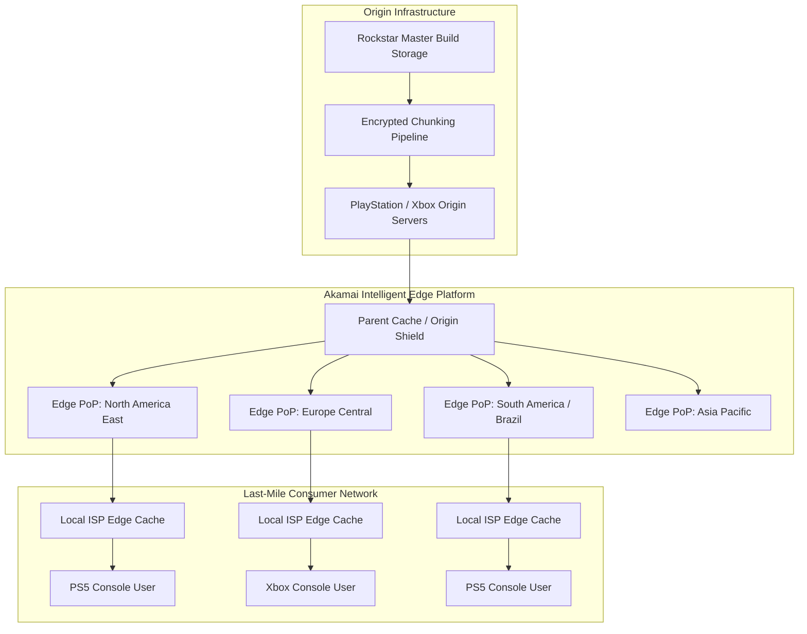
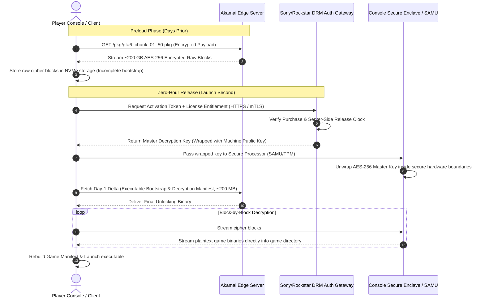

## 1. The Traffic Threat of a 200 GB Launch

Releasing *Grand Theft Auto VI* creates a severe stress test for Tier-1 network transit providers, internet service providers (ISPs), and edge delivery networks. At a rumored **~200 GB to 212 GB**, the game is twice the size of a typical AAA release.

If 15 million players hit "Install" at launch, game assets, cutscenes, world geometry, and textures hit the network simultaneously, creating a massive thundering herd problem. To keep Internet Exchange Points (IXPs) and last-mile links from saturating, modern game distribution relies on edge preloading, chunked caching, and client-side hardware decryption.

---

## 2. The Math: Why Simultaneous Day-One Downloads Fail

Using conservative estimates for digital launch purchases across PlayStation 5 and Xbox Series systems:

- Digital pre-orders and day-one installs ($N$): $15,000,000$ users
- Download payload size ($S$): $200\text{ GB} = 200 \times 10^9\text{ bytes} \approx 1.6 \times 10^{12}\text{ bits}$
- Total payload ingest: 
  $$Total = N \times S = 15,000,000 \times 200\text{ GB} = 3,000,000,000\text{ GB} = 3\text{ Exabytes (EB)}$$

In bits:
$$3\text{ EB} = 3 \times 10^{18}\text{ Bytes} \times 8 = 24 \times 10^{18}\text{ bits} = 24\text{ Exabits (Eb)}$$

### Scenario A: Simultaneous Launch Without Preloading

If all users attempt to download the client within a two-hour launch window ($t = 7,200\text{ seconds}$):

$$\text{Required Average Bandwidth} = \frac{24 \times 10^{18}\text{ bits}}{7,200\text{ seconds}} \approx 3.333 \times 10^{15}\text{ bits/sec} = 3,333\text{ Terabits per second (Tbps)} = 3.33\text{ Petabits per second (Pbps)}$$

Global peak traffic delivered by major CDNs typically runs in the hundreds of Terabits per second. A spike of $3.33\text{ Pbps}$ would exhaust border gateway transit buffers, trigger ISP throttling, congest peering links, and cascade timeouts into authentication servers.

### Scenario B: Preloading Across Seven Days

Spreading preloads across **7 days (168 hours)** flattens the demand spike:

$$t = 168\text{ hours} = 604,800\text{ seconds}$$
$$\text{Average Bandwidth Load} = \frac{24 \times 10^{18}\text{ bits}}{604,800\text{ seconds}} \approx 39.68\text{ Tbps}$$

A sustained baseline of $\approx 40\text{ Tbps}$ across global edge nodes falls well within standard CDN operating capacity.

---

## 3. The Akamai CDN Architecture: Warming the Global Edge

Rockstar and platforms like Sony (PlayStation Network) use Akamai's Content Delivery Network, deploying EdgeServers directly inside Tier-2 and Tier-3 ISP networks.

### Staging and Cache Warming

As noted by developer **@vctgomes**, preloading packages are staged well before release:

1. Encrypted `.pkg` chunks and patch catalogs (`PPSAXXXXX`) are uploaded to origin servers and synchronized across intermediate parent caches.
2. The archive is partitioned into discrete $2\text{ GB}$ to $4\text{ GB}$ chunks (over 50 segments) rather than delivered as a single 200 GB file.
3. Through Akamai Aura Managed CDNs and peering agreements, popular chunks are pushed to edge servers in the consumer's local subnet before downloads begin, minimizing latency and backbone transit.

---

## 4. Cryptographic Security: Preventing Early Access

When download links and manifests surfaced before release, users attempted to capture packages through Wireshark or proxies to inspect binaries and extract assets.

As pointed out by **@vctgomes** in community discussions:

> *Not to mention it is encrypted and the key only arrives on launch day. The pre-release file is never complete; there is always an update at launch containing the final files.*

### How Modern Preload DRM Operates

Preloaded content on modern consoles and PC clients remains inert data on disk until activation.

### Preload Security Controls

1. The 200 GB data block (textures, meshes, audio) is encrypted with AES-256 in counter (CTR) or cipher block chaining (CBC) mode, preventing decryption without the symmetric key.
2. The primary executable (`.elf` or `.exe`), startup scripts, and root manifests are omitted from the preload package, leaving no runnable entrypoint on disk.
3. On PS5, the AMD APU includes a dedicated cryptographic coprocessor (the Secure Asset Management Unit, or SAMU). The decryption key delivered at launch is encrypted with the console's unique device key, preventing it from appearing in plaintext host RAM where debuggers or hypervisors could inspect it.
4. The client merges the preloaded archive with a small launch-day patch, fixing last-minute bugs without requiring a re-download of the base assets.

---

## 5. Launch-Hour Processing: In-Place Decryption

Once the license server releases the decryption key, the bottleneck shifts from network bandwidth to disk I/O and CPU throughput.

Consoles handle unpacking through three steps:

1. NVMe drives handle read and write rates above 5,000 MB/s while streaming data through SIMD hardware-accelerated AES instructions (such as AMD Zen AES-NI), decrypting blocks in place or writing to pre-allocated sectors.
2. Every decrypted block is checked against a SHA-256 or BLAKE3 Merkle tree manifest. If a block fails verification, the client requests only that specific byte range rather than re-downloading the full package.
3. The client applies the small launch patch (usually a few hundred megabytes to two gigabytes), indexes the files, sets permissions, and marks the game binary as executable.

---

## 6. Why Preloading Matters

Delivering a 200 GB release to millions of players at once requires coordinating three layers of infrastructure: Akamai's edge network absorbs traffic across a week-long window, byte-range chunking prevents local network congestion, and hardware cryptography protects the game assets until launch.

Preloading is not merely a user convenience; it is the traffic-shaping mechanism that keeps massive digital releases from overwhelming transit providers and ISP networks.

---

### Acknowledgments & References

- **Victor Gomes** ([@vctgomes on X](https://x.com/vctgomes/status/2120005275809710589?a=HZQ-DbPa0gVZUre64ko&s=19)) for analysis on asset staging, package structures, and console encryption.
- Akamai Edge Network architecture papers and Sony PSN content distribution documentation.
