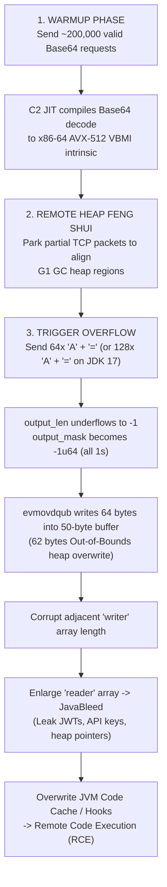
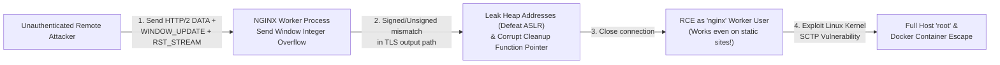
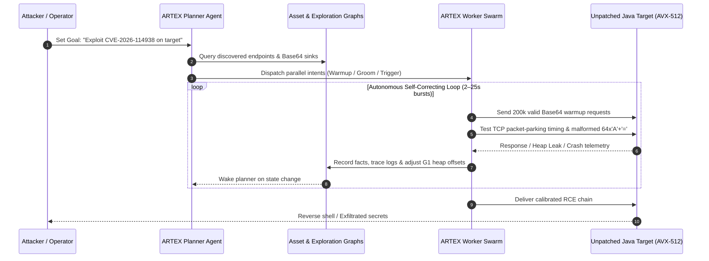

In mid-November 2026, disclosures for two unauthenticated Remote Code Execution (RCE) vulnerabilities were published for OpenJDK and NGINX:

1. Java4Shell (`CVE-2026-114938`): A heap memory corruption vulnerability in OpenJDK's hardware-accelerated Base64 decoder ([calif.io/java4shell](https://calif.io/java4shell)).
2. NGINX2Root (`CVE-2026-123007` and companion flaws): Five NGINX RCE vulnerabilities, centered on an HTTP/2 flow-control integer overflow dormant since 2015, chained with a Linux kernel SCTP vulnerability to obtain host `root` ([nginx2root.com](https://nginx2root.com/)).

Despite aggressive branding, both issues represent genuine infrastructure risks. This guide details the root causes of both vulnerabilities, how autonomous security agents uncovered them, why static NGINX configurations remain exposed, and the immediate patching steps required.

---

## Conceptual Overview

### Java4Shell: Base64 Assembly Underflow
While Java enforces memory safety within standard bytecode, high-throughput routines like Base64 decoding often bypass bytecode in favor of hand-optimized assembly intrinsics executed directly on the CPU.

When processing malformed Base64 input containing 64 `A` characters followed by a trailing `=` padding character, the intrinsic's padding calculation subtracts below zero (`0 - 1 = -1`). Because the counter is treated as an unsigned bitmask, `-1` evaluates to all ones, causing the CPU to write a full 64-byte vector.

Although Java detects the malformed padding and raises an `IllegalArgumentException`, the out-of-bounds write occurs first, overwriting 62 bytes past the allocated buffer. In heap arrangements with adjacent memory structures, attackers can use this overrun to leak adjacent memory (referred to as JavaBleed) or overwrite JVM internal pointers to achieve code execution.

### NGINX2Root: HTTP/2 Flow-Control Integer Mismatch
In HTTP/2, NGINX tracks client window sizes to regulate how much data can be sent without overwhelming the receiver.

Under `CVE-2026-123007`, an attacker requests data, transmits a `WINDOW_UPDATE` frame while output remains queued, and abruptly sends a `RST_STREAM` frame. When processing the stream reset, NGINX refunds credits while retaining the replenished window, driving the window counter past its upper limit. A signed-versus-unsigned integer mismatch then causes NGINX to miscalculate buffer capacity.

This condition allows an attacker to leak memory addresses, bypass Address Space Layout Randomization (ASLR), and overwrite internal connection cleanup function pointers. Once shell execution is achieved as the unprivileged `nginx` worker process, attackers can exploit a separate vulnerability in the Linux kernel SCTP module to escalate to `root`.

---

## Discovery via AI Security Tools

Both OpenJDK and NGINX have undergone automated fuzzing via OSS-Fuzz and repeated code audits for decades. However, the discovery process for both disclosures was driven primarily by LLM-assisted and autonomous security tooling:

- For Java4Shell, security researcher Quang Luong at Calif.io directed OpenAI's Codex to audit boundary conditions within HotSpot JIT compiler intrinsics. Focusing the model on Base64 vector decoding uncovered the assembly mask underflow within one hour, yielding a working exploit two hours later at an estimated cost under $200 in API tokens.
- For NGINX2Root, security firm Theori deployed Xint, an autonomous penetration testing system, against a 50,000-line module of NGINX source code. Xint identified the HTTP/2 flow-control corruption bug within 90 minutes and generated reproduction parameters. Incorporating these findings into the tool's harness subsequently identified four additional NGINX vulnerabilities without further human guidance.

### Dormant Vulnerabilities in Core Infrastructure

These flaws persisted across long operational lifespans because auditing legacy C state machines and low-level SIMD assembly is labor-intensive:
- `CVE-2026-123007` (HTTP/2 flow control) was introduced in NGINX 1.9.5 in 2015, remaining undetected for 11 years. Shodan telemetry indicates that 98.9% of version-identifiable NGINX instances (approximately 11.8 million servers) were running releases within the vulnerable range.
- `CVE-2026-123634` (DNS resolver use-after-free) and `CVE-2026-113425` (mail proxy use-after-free) trace back to NGINX versions 0.6.18 and 0.5.33, representing code written 15 to 18 years ago.

---

## Technical Details: Java4Shell (CVE-2026-114938)

### Technical Architecture & Exploit Flow
The vulnerability lives in OpenJDK HotSpot's C2 JIT compiler intrinsics for x86-64 CPUs supporting **AVX-512 VBMI** (`VMOVDQU8` / `evmovdqub`). Because Java only compiles a method into this native intrinsic after it becomes "hot," an attacker must first warm up the endpoint before triggering the heap overflow and performing **Remote Heap Feng Shui** against the G1 Garbage Collector.



### Affected Java Versions & Hardware Constraints
Exploitation requires matching both software and hardware conditions:
* Affected releases: OpenJDK `17.0.6` and newer (covering Java 17, 21, 25, and 27 release lines), including Oracle Java SE, Oracle GraalVM, Amazon Corretto, Eclipse Temurin, Microsoft Build of OpenJDK, Azul Zulu, BellSoft Liberica, SAP SapMachine, and Red Hat OpenJDK.
* Hardware requirements: Execution requires an x86-64 CPU supporting AVX-512 VBMI instructions (Intel Ice Lake, Sapphire Rapids, Emerald Rapids, Granite Rapids; AMD EPYC/Ryzen Zen 4 or newer). ARM64 architectures (AWS Graviton, Apple Silicon, Ampere) do not implement this intrinsic and are not vulnerable.
* Confirmed vulnerable applications in default configurations:
  * Unauthenticated RCE: Keycloak, Atlassian Jira, Atlassian Confluence, JFrog Artifactory, Jenkins, and PingFederate, plus endpoints passing untrusted tokens or headers to Base64 decoders in Spring Security, Tomcat, Jetty 12, and `java-jwt`.
  * Post-authentication RCE: Apache Kafka Broker, Apache Solr, Elasticsearch, Gerrit, and Spinnaker.

### Immediate Java4Shell Remediation
1. Verify CPU instruction support on Linux hosts:
   ```bash
   grep -m1 '^flags' /proc/cpuinfo | tr ' ' '\n' | grep -E '^(avx512f|avx512bw|avx512vbmi|bmi2)$'
   ```
   *(If all four flags appear, the hardware supports the vulnerable intrinsic.)*
2. Upgrade to the November 17, 2026 OpenJDK / Oracle CPU builds (`17.0.22+`, `21.0.14+`, `25.0.6+`, `27.0.2+`, or distribution backports).
3. Emergency JVM flag workaround (x86-64 only): If immediate JDK updates cannot be deployed, add `-XX:-UseBASE64Intrinsics` to `JAVA_OPTS`. Do not use `-XX:UseAVX=2` in multi-architecture fleets, as ARM64 JVMs will crash on startup if passed an x86 AVX flag.

---

## Technical Details: NGINX2Root (CVE-2026-123007 & Companion CVEs)

NGINX2Root consists of five distinct NGINX RCE vulnerabilities along with a Linux kernel local privilege escalation (LPE) flaw:

| CVE ID | Bug Type | Vulnerable NGINX Config | Affected Releases | Mitigated by Disabling HTTP/2? |
| :--- | :--- | :--- | :--- | :--- |
| **`CVE-2026-123007`** | Integer overflow in HTTP/2 flow control | Any listener with `http2` enabled (default HTTPS setups) | `1.9.5` to `1.31.8` | **Yes** |
| **`CVE-2026-123633`** | Use-after-free on HTTP/2 connection draining | HTTP/2 + upstream (`proxy_pass`, `fastcgi_pass`, `grpc_pass`) | `1.19.7` to `1.31.8` | **Yes** |
| **`CVE-2026-123634`** | Use-after-free in DNS resolver | `resolver` + variable `proxy_pass` + `mirror` (`mirror_request_body off`) | `0.6.18` to `1.31.8` | **No** |
| **`CVE-2026-121810`** | Use-after-free on HTTP/3 connection close | HTTP/3 (`quic`) + upstream forwarding | `1.25.0` to `1.31.8` | **No** |
| **`CVE-2026-113425`** | Use-after-free in mail proxy auth | Mail proxy with `proxy on` and `auth_http` | `0.5.33` to `1.31.8` | **No** |

### The Full NGINX-to-Root Attack Chain



### Impact on Static Asset Hosting
Even NGINX instances that only serve static assets (such as Astro or React static bundles) without backend application proxies are vulnerable. `CVE-2026-123007` resides in NGINX's HTTP/2 framing logic, triggering before the server evaluates request routing or file system access. Researchers at Theori and Wiz verified RCE and ASLR bypass against default NGINX deployments serving static files over TLS with HTTP/2 enabled.

Compromising an unprivileged `nginx` worker process exposes the host to several risks:
* Injecting malicious scripts or payloads into cached static assets
* Exfiltrating TLS private keys and host environment variables
* Pivoting laterally across VPC or container networks
* Escalating to `root` and escaping container boundaries via the Linux kernel SCTP flaw

### Immediate NGINX2Root Remediation
### Immediate NGINX2Root Remediation
1. Audit active NGINX binaries and configurations:
   ```bash
   nginx -v
   nginx -V 2>&1 | grep -o -- '--with-http_v2_module'
   sudo nginx -T 2>&1 | grep -nE 'listen.*http2|http2\s+on;'
   ```
2. Upgrade to NGINX `1.31.9` (or `1.30.7` / distribution backports) and restart the service completely. Running `nginx -s reload` does not replace running binaries in memory; a full service restart (`systemctl restart nginx`), container replacement, or live binary upgrade (`USR2` + `WINCH` + `QUIT`) is required.
3. Workarounds if binary upgrades cannot be applied immediately:
   * On NGINX 1.25.1 and newer, add `http2 off;` to server blocks and remove `http2` from `listen` directives.
   * On NGINX 1.9.5 through 1.25.0, remove `http2` from `listen 443 ssl http2;`.
   * Verify externally that HTTP/2 (`h2`) is no longer negotiated:
     ```bash
     openssl s_client -connect yourdomain.com:443 -servername yourdomain.com -alpn h2 </dev/null 2>&1 | grep 'ALPN protocol'
     ```
4. Block the kernel SCTP escalation path: Prevent the `sctp` kernel module from auto-loading on hosts that do not require it:
   ```bash
   echo "install sctp /bin/false" | sudo tee /etc/modprobe.d/disable-sctp.conf
   ```

---

## Exploit Complexity and Autonomous Tooling

Exploit viability differs between the two vulnerabilities:
* NGINX2Root (`CVE-2026-123007`): Moderate complexity with high reliability. The bug requires no authentication, operates remotely over HTTPS, and bypasses ASLR deterministically via memory leakage in the HTTP/2 output path. While initial advisories omitted full payload chains, crash triggers and reproduction methods are public.
* Java4Shell (`CVE-2026-114938`): High complexity requiring target-specific heap alignment. Because G1 Garbage Collector heap layouts vary across runtimes and workloads, exploitation requires warming up the JIT compiler, timing partial TCP packet deliveries to groom heap regions, and adjusting for latency variations. In their testing, Calif researchers deployed test instances within the same AWS cloud region to minimize latency jitter. Upstream reverse proxies that buffer complete HTTP request bodies can interfere with packet-parking sequences, though direct endpoints (such as Elasticsearch or WebSocket connections) remain accessible.

### Automated Exploitation via BaaRai/ARTEX
While complex heap-grooming exploits historically required manual calibration for each target environment, autonomous security frameworks reduce that turnaround time. An example is BaaRai/ARTEX, an open-source offensive security platform maintained as a fork of Autumn-27/ARTEX. The framework uses a Go-based coordinator and multi-agent architecture to automate vulnerability scanning and exploitation. Threat intelligence groups, including CrowdStrike and Google Threat Intelligence Group, have reported threat groups utilizing ARTEX variants.

The interaction model illustrates how multi-agent frameworks automate heap calibration:



Rather than relying on manual offset adjustments, the framework pairs an Asset Graph with an Exploration Graph to execute repeated test probes. By analyzing HTTP response timing, status changes, and service restarts, the agents iterate on heap alignment parameters automatically.

---

## Vulnerability Branding and Defensive Priorities

Frequent branded vulnerabilities (`Log4Shell` in 2021, `Spring4Shell` in 2022, `React2Shell` in 2025, `PHP2Shell` in 2026, and now `Java4Shell` and `NGINX2Root`) often generate fatigue among engineering teams. Security practitioners and researchers have noted several operational takeaways:

* Detection engineers including Florian Roth ([@cyb3rops](https://x.com/cyb3rops/status/2123134097186783287?a=35SwDvYAKKhywuP857g&s=20)) and [@Laughing_Mantis](https://x.com/Laughing_Mantis/status/2123146699396858260?a=uAX_pyOJxkKKmN4PpW4&s=20)) emphasize tracking indicators of compromise (IOCs) and memory corruption patterns rather than focusing on marketing collateral.
* Security researchers including [@hakluke](https://x.com/hakluke/status/2122709101692219739?a=eRLp2l73WBMIZ82EvFs&s=20), [@JamesBerthoty](https://x.com/JamesBerthoty/status/2122852392991646062?a=tXGUbQnRuqJLQe5LILg&s=20), and [@shindo_ryo](https://x.com/shindo_ryo/status/2122823729386492175?a=yn_G7dLew3ydKWlpWTE&s=20) highlight how automated discovery tools increase the rate at which legacy infrastructure vulnerabilities are surfaced, accelerating required patching cycles.
* Threat intelligence teams such as Cloudflare's [@Cloudforce_One](https://x.com/Cloudforce_One/status/2123175079513338095?a=VREqFyZh1QoRSdT5b_s&s=20) observe widespread automated scanning following disclosure, noting that edge WAF filtering provides temporary mitigation while underlying runtime binaries and web servers must be updated directly.

Regardless of disclosure branding, unauthenticated memory corruption in widespread web servers and runtime decoders requires prompt remediation.

---

## Immediate Patching Checklist

1. Inventory external-facing NGINX and Java endpoints, prioritizing ingress controllers, API gateways, static hosting proxies, identity providers, and CI/CD instances.
2. Update OpenJDK installations across x86-64 servers to the November 17, 2026 release lines (`17.0.22+`, `21.0.14+`, `25.0.6+`, `27.0.2+`), or set `-XX:-UseBASE64Intrinsics` in JVM launch options.
3. Deploy NGINX 1.31.9 (or distribution backports) and restart server processes completely. If upgrading is blocked, disable HTTP/2 on public listeners.
4. Disable the `sctp` kernel module in `/etc/modprobe.d/` to mitigate local privilege escalation while awaiting kernel distribution updates.

---

## References & Further Reading

* Java4Shell Research and PoC: [Calif.io: Java4Shell: Write once, RCE everywhere (`CVE-2026-114938`)](https://calif.io/java4shell)
* NGINX2Root Advisory and Technical Writeup: [Theori Xint: NGINX2Root (`CVE-2026-123007` & Companion Flaws)](https://nginx2root.com/)
* Autonomous AI Security Harness: [GitHub: `BaaRai/ARTEX`](https://github.com/BaaRai/ARTEX)
* Practitioner Commentary and Analysis:
  * [@Cloudforce_One Status Update](https://x.com/Cloudforce_One/status/2123175079513338095?a=VREqFyZh1QoRSdT5b_s&s=20)
  * [@Laughing_Mantis Status Update](https://x.com/Laughing_Mantis/status/2123146699396858260?a=uAX_pyOJxkKKmN4PpW4&s=20)
  * [@cyb3rops Status Update](https://x.com/cyb3rops/status/2123134097186783287?a=35SwDvYAKKhywuP857g&s=20)
  * [@hakluke Status Update](https://x.com/hakluke/status/2122709101692219739?a=eRLp2l73WBMIZ82EvFs&s=20)
  * [@JamesBerthoty Status Update](https://x.com/JamesBerthoty/status/2122852392991646062?a=tXGUbQnRuqJLQe5LILg&s=20)
  * [@shindo_ryo Status Update](https://x.com/shindo_ryo/status/2122823729386492175?a=yn_G7dLew3ydKWlpWTE&s=20)