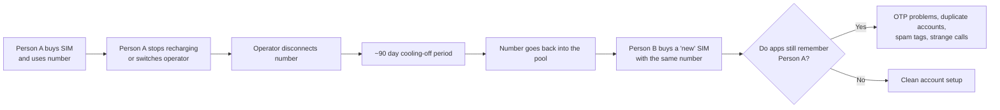
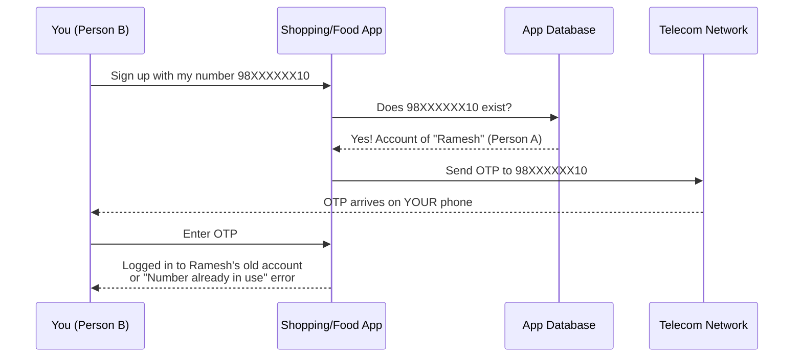
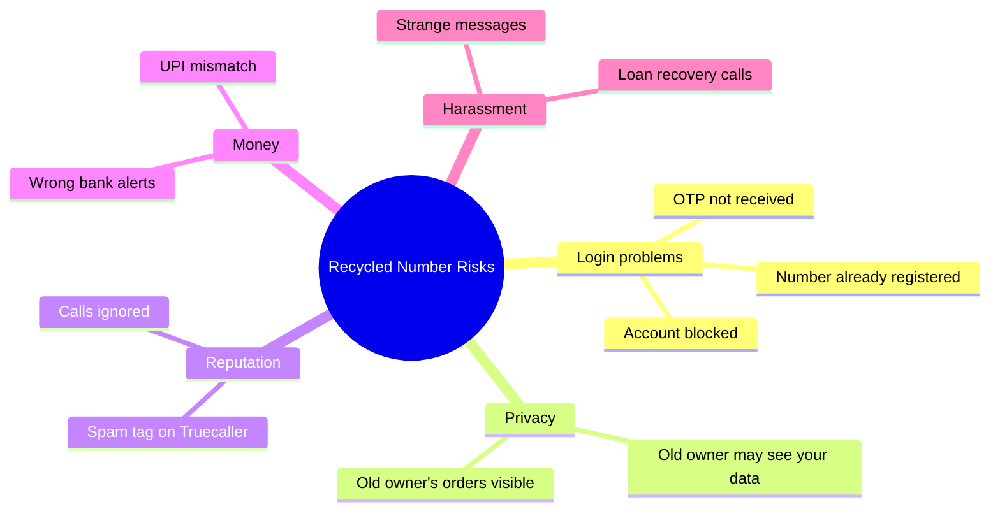
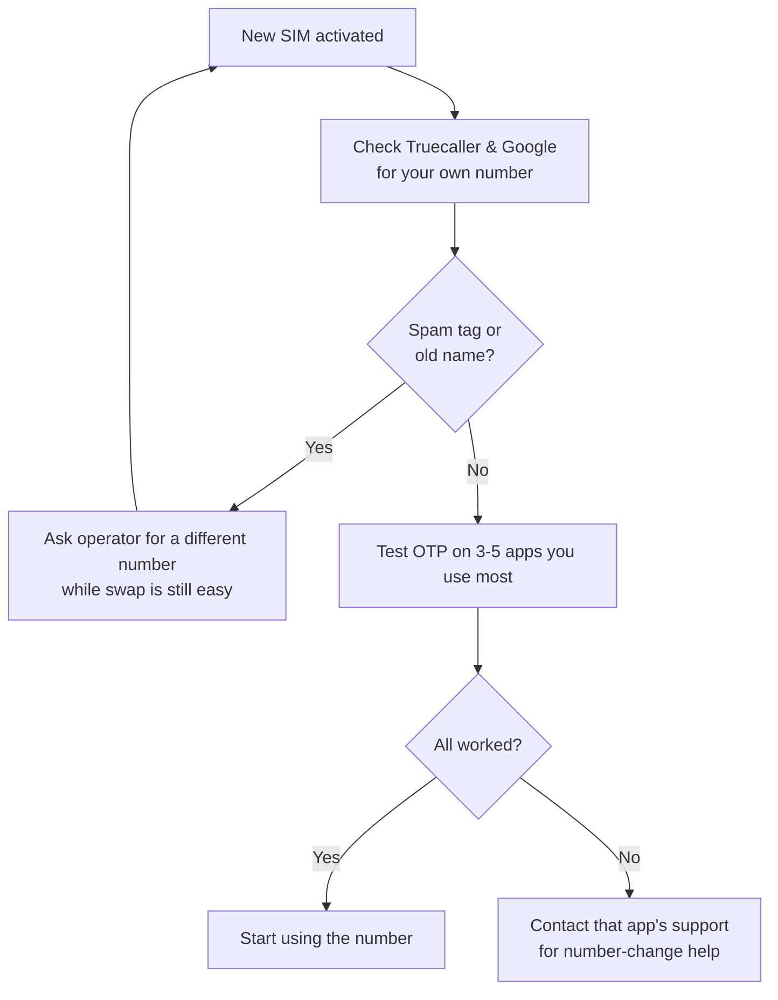

import { Image } from 'astro:assets';

import unboxNewsimImage from '../../assets/blog/unbox-new-sim-comic.png'
import ghostSimrecordsImage from '../../assets/blog/ghost-sim-records-comic.png'
import investigateSimhistoryImage from '../../assets/blog/investigate-sim-history-comic.png'
import freshSimImage from '../../assets/blog/fresh-sim-comic.png'

A developer's explanation of recycled mobile numbers, for everyone waiting for an OTP that never comes.

<Image src={unboxNewsimImage} alt="A person happily unboxing a new SIM card while a ghost labelled 'Previous Owner' waves from inside the SIM tray" style={{ marginBottom: "0.5rem", marginTop: "1rem" }} />

## The story everyone has heard but nobody explains

You pick up a new SIM from a Jio or Airtel store, or order one online, expecting a clean slate.

A day later, odd issues crop up:

- Swiggy reports that your number is already registered.
- Flipkart never delivers your OTP.
- Strangers message you on WhatsApp asking for someone else.
- Truecaller flags your incoming calls as spam or displays an unfamiliar name.
- You receive debt-recovery texts meant for a stranger.

Nothing is broken on your phone. The number simply belonged to someone else before you bought it. As a software developer, friends and family ask me about this frequently. Telecom recycling causes real headaches across consumer apps, but understanding why apps break makes it much easier to deal with.

---

## What is a recycled mobile number?

India relies on a finite pool of 10-digit mobile numbers. When a customer disconnects a line, switches operators, or stops recharging, the carrier does not retire that number permanently. After a holding period, the operator reissues it to someone else.

TRAI regulations require telecom providers to hold a disconnected number for roughly 90 days before reassigning it. That window is called the cooling-off period.

While the telecom operator clears its subscriber records after 90 days, consumer apps, banks, and third-party services rarely know the number changed hands.

---

## Why do apps cause trouble? (A developer's view)

Most consumer apps in India treat your mobile number as your primary identity. When you register, the database maps your profile directly to that number:

| What the app saves | Example |
|---|---|
| Phone number | 98XXXXXX10 |
| Name | Ramesh K. |
| Saved addresses | Anna Nagar, Chennai |
| Payment methods | UPI ID, saved cards |
| Order history | 42 orders |

In database design, the phone number is the primary key: an identifier assumed to belong to one person indefinitely. But in reality, phone numbers circulate. Most applications have no automated connection to carrier databases to verify whether the person holding the SIM today is the person who registered the account three years ago.

When you try to sign up with a recycled number, the application either treats you as the previous owner or rejects the request as a duplicate entry.

Depending on the service, you might be logged straight into the prior owner's profile, locked out by an error screen, or flagged by an automated fraud filter.

<Image src={ghostSimrecordsImage} alt="A confused shopper in a queue behind a counter clerk holding a large register labelled 'Phone Number Records\'" style={{ marginBottom: "0.5rem", marginTop: "1rem" }} />

---

## The risks of a recycled number

A recycled number can cause practical and security problems across several everyday services:

- **Account lockouts and login failures:** You cannot sign up for services like Flipkart, Swiggy, Zepto, Blinkit, or BookMyShow because the system insists an account already exists, or the OTP never arrives.
- **Exposure of the prior owner's personal data:** You might see the previous owner's past orders, saved home addresses, and full name. This compromises their privacy and creates an awkward situation for you.
- **Exposure of your own data to the prior owner:** If the previous owner still has the old number linked to active apps, they might attempt a login or trigger password resets. While OTPs arrive on your SIM, any service that falls back to email or cached sessions might expose shared account activity. Never share an OTP you did not request.
- **Spam and scam tags:** Caller ID directories like Truecaller and GetContact rely on crowd-sourced tags. If the prior user was flagged for telemarketing or spam, your outbound calls inherit that label, causing people to ignore you.
- **Banking and UPI confusion:** Banks send transaction alerts and OTPs to registered numbers. If the previous owner failed to update their records, their bank notices may land on your phone. NPCI and major banks regularly prune inactive and reassigned numbers from UPI registries, but the process is not instantaneous. Never interact with bank alerts that belong to someone else.
- **Debt-collection calls:** Collection agencies and delivery drivers may call looking for the earlier subscriber.
- **Automated fraud flags:** Risk-engine rules often restrict the number of accounts associated with a single phone number or device footprint. A recycled number with a messy history can trigger false positives on new registrations.

---

## How to check before it is too late

You cannot run a comprehensive check ahead of time. No public database shows whether Flipkart, Swiggy, Instagram, or a bank still associates your number with someone else, because that user data is confidential.

However, you can run a quick check during your first day with the SIM:

### Step 1: Check the number's reputation
- Search your number on Truecaller, GetContact, or Eyecon to see if it carries spam flags or someone else's name.
- Search your number in quotation marks on Google: `"98XXXXXX10"`.

### Step 2: Check WhatsApp
- Register the number on WhatsApp. If it loads an existing profile picture or warns that the account is linked to another device, remnants of the previous account remain.

### Step 3: Test logins on services you use
Try signing up or using "Forgot password" on the platforms you use regularly, such as Google, Flipkart, Swiggy, Zepto, Blinkit, BookMyShow, Instagram, Facebook, Snapchat, and your banking app.

| Result | What it means | Recommended action |
|---|---|---|
| OTP arrives and a new account is created | Clean number | Continue setup |
| "Number already registered" appears | An account from the previous owner exists | Contact support or use the app's number-update flow |
| No OTP arrives | Number is flagged or SMS delivery failed | Wait a day, retest once, then reach out to support |
| Unsolicited OTP arrives for a service you do not use | Previous owner is attempting access | Do not share the OTP; contact support |

> Tip: Avoid requesting repeated OTPs in a short window. Rapid attempts often trigger rate limits and automated fraud locks. Request one code, wait, and retry later if needed.

<Image src={investigateSimhistoryImage} alt="A detective with a magnifying glass inspecting a SIM card labelled 'Is this number clean?'" style={{ marginBottom: "0.5rem", marginTop: "1rem" }} />

---

## How to avoid the problem altogether

Managing a phone number takes a bit of planning before purchase and during the first few weeks.

### Before taking the SIM
- If a chosen number looks suspicious or comes with warning flags, ask the vendor for an alternative. Retailers typically have multiple SIM cards on hand.
- Request a freshly allocated number series if the store has one available.
- Buy directly from official carrier stores or authorized outlets so that KYC documents and registration records are processed accurately.

### On day one
- Complete the reputation and login checks while returning to the store for an exchange remains straightforward.
- Test the number before handing it out to employers, schools, or clients.

### In the first few weeks
- Update your contact details across essential services: your bank, UPI handles, insurance policies, Aadhaar, email recovery options, and primary ecommerce accounts.
- Configure an authenticator app or email recovery fallback wherever possible so your security does not rely solely on SMS codes.
- Review connections registered under your identity via the government's Sanchar Saathi portal (`sancharsaathi.gov.in`). Its TAFCOP utility lists mobile numbers registered against your ID so you can flag unrecognized lines.

### If problems surface
- Never disclose OTPs that arrive unexpectedly.
- Report persistent debt-collection calls or suspicious phishing texts to your carrier. For fraud, file a report through the national cyber helpline at 1930 or `cybercrime.gov.in`.
- Save screenshots of registration and login errors to provide clear evidence when opening support tickets.
- Reach out to customer service on affected apps to decouple the previous owner's profile and register your own.

---

## The reverse problem: giving up a number

When you stop using a mobile number, taking a few steps prevents headaches for both you and whoever inherits the line:

- Move your banking, UPI profiles, email accounts, ecommerce profiles, and WhatsApp to your new number before disconnecting the old one.
- Close unused online accounts instead of abandoning them.
- Unlink the line from payment instruments and two-factor authentication settings.

---

## A note for app builders

If you develop consumer applications, remember that a phone number is an ephemeral identifier, not a permanent identity:

- Offer email verification or authenticator app support alongside phone logins.
- Re-authenticate phone numbers periodically before permitting high-risk operations.
- Evaluate device signals and user behavioral patterns alongside SMS verification.
- Provide a clear self-service or support workflow for new SIM owners who need to reclaim a phone number from an abandoned profile.

---

## Frequently asked questions

**Is it legal for telecom operators to reissue numbers?**  
Yes. Under TRAI regulations, carriers are permitted to reassign disconnected numbers after a cooling-off period of approximately 90 days.

**Can I look up who owned my number previously?**  
Not through official channels. Caller identification apps like Truecaller may display a prior user's name, but those records are crowd-sourced and may be outdated.

**Is there a universal tool to check a number across every app?**  
No. Platforms store user accounts in isolated private databases. The only practical check is to attempt registration on each service directly.

**What should I do if an OTP arrives for an account I do not own?**  
Never share the code. If the message relates to a bank or UPI transaction, notify the bank directly. For other services, notify customer support.

**Can the previous owner access my accounts?**  
They cannot access accounts that authenticate through your physical SIM, because incoming SMS codes route to your device. However, configuring secondary authentication like an authenticator app provides stronger protection.

**When does it make sense to just request a replacement SIM?**  
If the line carries severe spam flags on caller directories or receives continuous collection calls, asking your carrier for a replacement number is usually faster than resolving each issue individually.

---

## Summary

- A new SIM card often carries a history from a previous subscriber.
- While telecom providers release numbers after a 90-day cooling-off window, online services do not automatically purge dormant accounts.
- This mismatch leads to failed OTP delivery, duplicate registration errors, spam labels, and unwanted calls.
- Run a short check on day one by testing caller directories, WhatsApp, and your primary applications.
- Update your essential accounts promptly, enable non-SMS authentication methods, and swap the number early if severe conflicts appear.

<Image src={freshSimImage} alt="A happy person giving thumbs up with a tick-marked checklist and a fresh SIM" style={{ marginBottom: "0.5rem", marginTop: "1rem" }} />

---

*Share this with anyone setting up a new phone line to help them identify and fix recycled number issues early.*

**Disclaimer:** Regulatory policies, helplines, and government portals change over time. Refer to TRAI, the Department of Telecommunications (DoT), and your carrier's official channels for current guidelines.