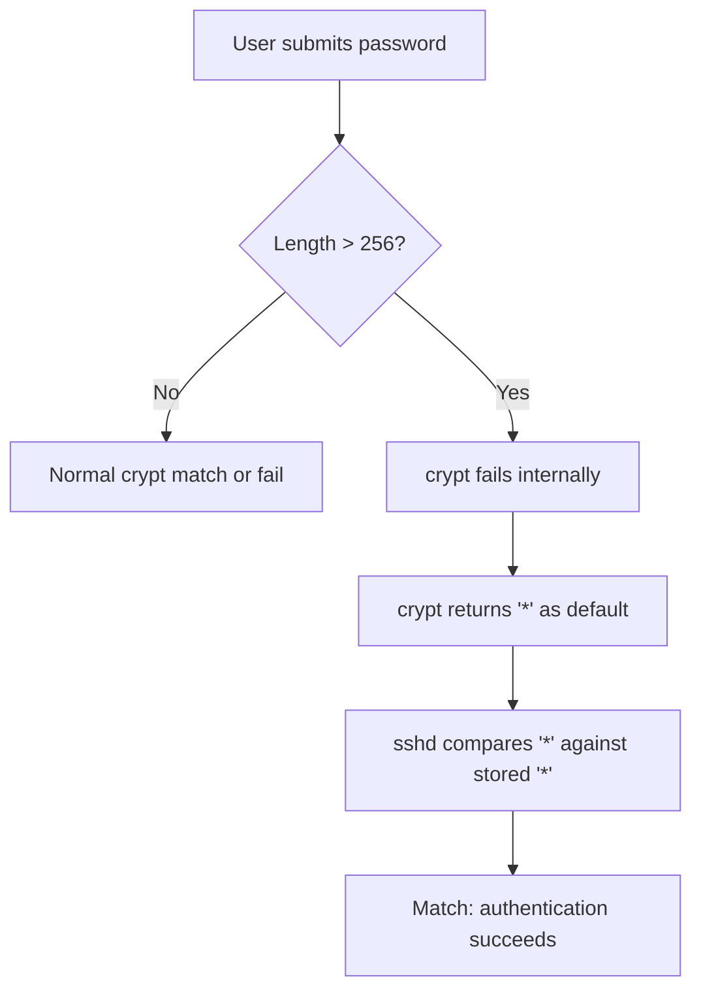

import { Image } from 'astro:assets';

import theLongWalkInComic from '../../assets/blog/the-long-walk-in-comic.png';
import sshholeMonsterComic from '../../assets/blog/sshhole-monster-comic.png';

Alpine Linux is commonly chosen for production containers because it is lightweight, fast, and uses musl libc instead of glibc. Within that minimal footprint, however, an edge case has allowed unauthenticated access to passwordless accounts since 2016.

Ozgun Kultekin published a write-up of the issue at [sshole.com](https://sshhole.com) (with details on [ozgun kultekin](https://ozgun.sh/)). The vulnerability comes from an intersection of a 1980s Unix convention, a 2012 musl crash-prevention patch, and a 2024 security review that pinpointed why authentication breaks.

Deployments running OpenSSH on Alpine without PAM may have this backdoor open.

---

## The anatomy of the bug: why a star is a door

In early Unix, `/etc/passwd` was world-readable, and an asterisk (`*`) in the password field designated an account without a usable password. Modern systems store hashes in `/etc/shadow`, but many utilities still treat `*` as a sentinel value.

The vulnerability relies on a four-step failure sequence:

1. Under normal conditions, `crypt()` should return `NULL` when an input cannot be processed.
2. In 2012, musl modified `crypt()` so that instead of crashing on a `NULL` result, it returns a single-character string, `"*"`, intended as an invalid hash that should never match legitimate input.
3. OpenSSH's password authentication path compares the value returned by `crypt()` directly against the hash stored in the system password file.
4. When a user supplies a password longer than 256 characters, musl's SHA-512 `crypt()` implementation fails internally and returns `"*"`. If the target account has `*` listed as its password hash (a standard default for root, system accounts, and LDAP users), the comparison succeeds.

Supplying a password of 257 or more characters to an account with a `*` password causes the `sshd` verification check to match, granting access.

### The flow of failure

---
<Image src={theLongWalkInComic} alt="The Long Walk In" style={{ marginBottom: "0.5rem", marginTop: "0.5rem" }} />
---

## How the attack scales (from scan to shell)

The risk is severe because scanning and exploiting exposed Alpine containers can be automated easily across the public internet.

### 1. The GitHub scraper attack
Most containerized services define their environments in Dockerfiles. An automated scraper can search GitHub or GitLab for `FROM alpine` or `FROM alpine:latest`. If the Dockerfile sets up SSH using `ssh-keygen` or includes flags like `-e a.k.a. -p` on the root user without specifying an explicit password, the image defaults to a `*` password hash, making it vulnerable once built and deployed.

### 2. Network scanning with nmap and zmap
Attackers can scan for vulnerable instances across internet IP ranges:
1. Scan port 22 with `nmap -sV`.
2. Check for OpenSSH banners where stderr output lacks the `--PAM` flag, indicating Alpine's default build.
3. Send a 257-character string of `A`s (the "ozone" password) against the `root` account.

### 3. Automated exposure on non-PAM systems
A chart on [sshole.com](https://sshhole.com) outlines how the vulnerability persisted until 2026. The flaw remained unnoticed for years because major Linux distributions rely on PAM, and `pam_authenticate` does not invoke the vulnerable `crypt()` code path for accounts locked with `*`. Environments in the sshone zone that bypass PAM rely entirely on the fallback logic in OpenSSH and musl.

---

## The fix

Systems running OpenSSH on Alpine can eliminate the long-password bypass using two approaches:

1. Upgrade to OpenSSH 10.6p2 or later, which patches the `pick_salt` logic so the `*` string cannot result in a successful match.
2. Disable password authentication entirely by setting `PasswordAuthentication no` in `sshd_config`. For installations that rely on SSH keys, this closes the attack vector without disrupting access.

<Image src={sshholeMonsterComic} alt="Sshhole Monster Comic" style={{ marginBottom: "0.5rem", marginTop: "0.5rem" }} />

---

## Summary
On Alpine systems without PAM, accounts configured with a `*` password (including root, system, or LDAP accounts) accept any password 257 characters or longer. To protect these systems, update `openssh` to version 10.6p2 or later, or set `PasswordAuthentication no`.

For the technical write-up, see [sshole.com](https://sshhole.com/).

