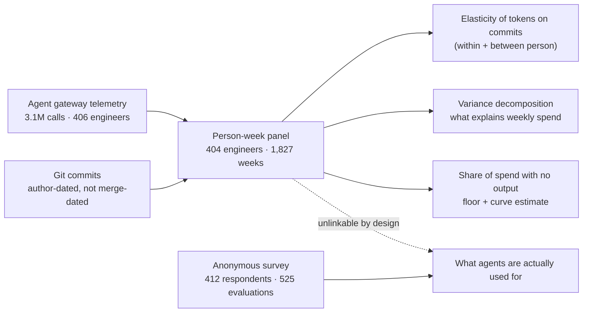
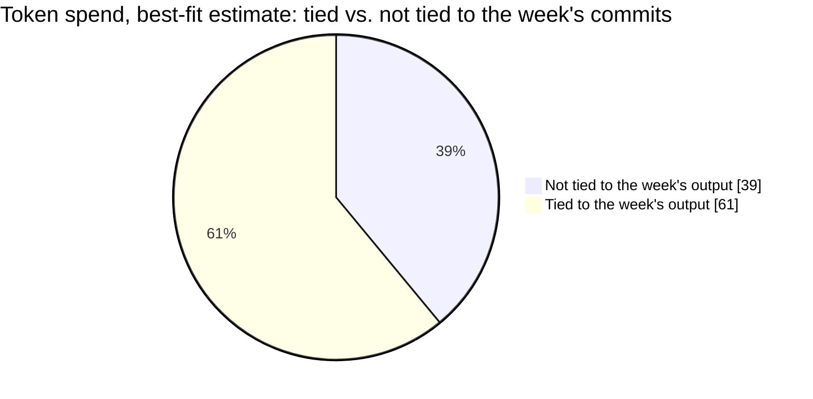
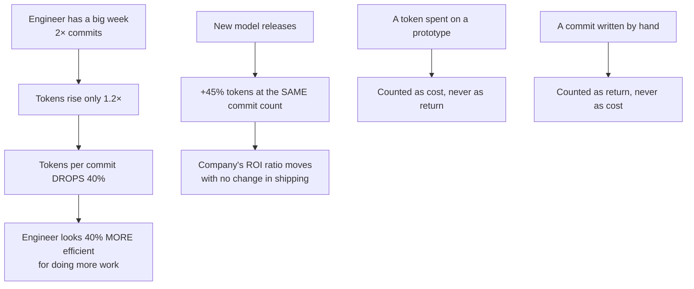
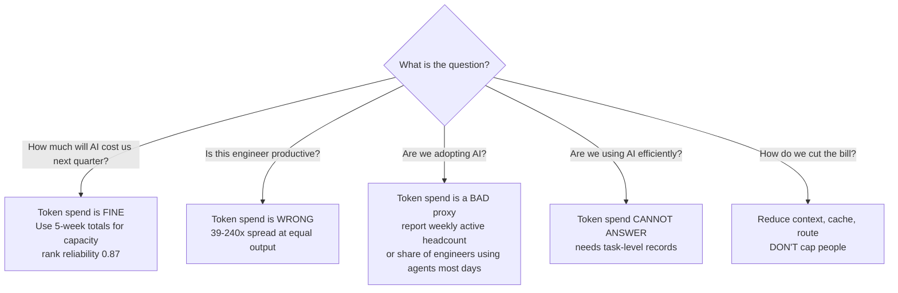

import { Image } from 'astro:assets';

import increasedTokenSpendImage from '../../assets/blog/increased-token-spend-illustration.png';
import tokenFunnelImage from '../../assets/blog/token-funnel-illustration.png';
import tokenVsCommitImage from '../../assets/blog/token-vs-commit-illustration.png';
import tokenSpendVsOutputImage from '../../assets/blog/token-spend-vs-output-illustration.png';
import tokenWrongMeasureImage from '../../assets/blog/token-wrong-measure-illustration.png';
import diverseTokenSpendImage from '../../assets/blog/diverse-token-spend-illustration.png';
import tokenSpreadImage from '../../assets/blog/token-spread-illustration.png';
import tokenPerPrIllustration from '../../assets/blog/token-per-pr-illlustration.png';
import goodhartIllustration from '../../assets/blog/toke-spend-goodhart-illustration.png';
import tokenUsageMetricTrashedIllustration from '../../assets/blog/token-usage-metric-trashed-illustration.png'

> **TL;DR** — Researchers linked 5 weeks of metered token usage to the actual commits of 404 engineers at JetBrains, plus a 412-person internal survey. A week with **twice an engineer's usual commits costs only ~20% more tokens**. A week with **twice the usual tokens produces only ~10% more commits**. Up to **39% of spend never varies with the week's output at all**, and **89% of agent use in the survey wasn't coding**. Token spend measures *how much you use agents*, not *what you shipped*.

---

## The "how many lines of code did you write?" of 2026

Every few years, leadership asks for a number that is easy to collect and looks like progress.

For a long time, it was lines of code. You've probably lived through this — the instinct to ask "just tell me how many lines each engineer wrote this week" makes every senior engineer in the room quietly die inside. LOC survived for decades because program size correlated loosely enough with effort to feed cost models (Fenton & Pfleeger; Albrecht). Eventually, it became a target and, per Goodhart's law as Strathern framed it, stopped being a good measure.

The 2026 remix is **token spend**.

Meta had an internal leaderboard where engineers competed to be the company's top token user; it got taken down after press coverage. Nvidia and Meta execs have said a good engineer should burn tokens worth a large share of their salary. Salesforce set minimum monthly spending targets. Uber burned its entire 2026 AI coding-tool budget in four months, and its COO admitted the link between token spend and shipped features "is not there yet."

Analytics vendors are already selling the ratio: **tokens ÷ merged pull requests = "return on investment."**

So a team at CMU and JetBrains measured it on the same engineers over time.

> **Paper:** *["The AI Era's Lines of Code? A Case Study on What an Engineer's Token Spend Measures"* — Agarwal, Lvova, Sergeyuk, Serova, Bryksin, Zimmermann, Vasilescu. arXiv:2611.13396](https://arxiv.org/abs/2611.13396).

The numbers are brutal.

<Image src={increasedTokenSpendImage} alt="Increased Token Spend" style={{marginTop:"1rem",marginBottom:"0.5rem"}} />

---

## The setup: 3.1 million agent calls, 1,827 engineer-weeks

JetBrains (~2,600 employees) runs an internal gateway that meters every coding-agent call in a consistent format. This allows for consistent comparison because everyone goes through the same door, regardless of model, harness, or caching regime.

Five complete weeks of overlap (2026-06-29 → 2026-08-02) provide the unit of analysis: the **person-week**. 404 engineers, 1,827 person-weeks, 88% of which have metered use. Median active week: 8 commits.

Two caveats:
1. These are associations, not causal effects. Engineers chose how much to use agents; nobody was randomized.
2. The setting is unusual. JetBrains builds AI coding tools, so some metered use may be dogfooding.

<Image src={tokenFunnelImage} alt="Token Funnel" style={{marginTop:"1.0rem",marginBottom:"0.5rem"}} />

---

## Finding #1: Double the commits, get 20% more spend

This is the headline number.

Fitting a Poisson model with person and week fixed effects (comparing each engineer's weeks to their own), the elasticity of tokens on commits is:

| Estimate | Value | 95% CI |
|---|---|---|
| Tokens on commits (within person) | **0.26** | [0.19, 0.32] |
| Commits on tokens (within person) | **0.13** | [0.03, 0.32] |

In plain English:
- **2× commits → ~20% more tokens** (2^0.26 ≈ 1.20)
- **2× tokens → ~10% more commits** (2^0.13 ≈ 1.09)

If spend were proportional to output — which is what "tokens per merged PR" assumes — both slopes would be ≈ 1.0. The product of the two slopes is **0.03**. Proportionality is rejected at every time unit tested, p < 0.001.

The authors also addressed common objections:

| Objection | What they did | Result |
|---|---|---|
| "Commits are a noisy proxy" | Instrumented commits with **lines changed** | Slope rises to 0.48 — still nowhere near 1 |
| "Output arrives later than spend" | Day-level cross-correlation, ±10 working days | Peaks **same day** (0.33), gone after ~4 working days |
| "Wrong time unit" | 1 day → 4 weeks | 0.30 (1 day), 0.21 (2 weeks) |
| "Wrong output metric" | Lines changed / days-with-commit | 0.19 / 0.40 |
| "Heavy-spend weeks just write bigger commits" | Commit size, platform share, issue linkage | No effect at p < 0.05 |

Between engineers, the slope is 0.38 on person. Engineers who spend 2× as much have about 8% more commits. Ten times the spend buys roughly **30% more output between engineers, 35% within** [7%, 109%].

Prior estimates align with this shape: Jellyfish's usage deciles (~10× spend → ~40% more output), a press summary of vendor data (10× → 2×), and He et al.'s enterprise "2× mandate" study (2.09× throughput, **≥20× spend**). Nobody's dashboard reflects it.

<Image src={tokenVsCommitImage} alt="Token vs Commit" style={{marginTop:"1.0rem",marginBottom:"0.5rem"}} />

---

## Finding #2: Same output, 39–240× different spend

If spend tracked output, two engineers shipping the same number of commits should cost roughly the same. They don't.

Within **every quintile of weekly commit counts**, the 90th percentile of token spend is **39 to 240 times** the 10th percentile. Even after controlling for all four activity metrics, the 90th-percentile person-week still uses **58×** the tokens of the 10th.

Over the full five weeks, the engineer at the 90th percentile of spend used **71×** the tokens of the engineer at the 10th.

The spread is wide because a token isn't a unit of work — it's a unit of *context*. **The median agent call sends about 400× as many tokens as it receives.** You're not paying for code; you're paying to re-send the conversation, the file contents, the terminal output, and the tool schemas on every turn.

<Image src={tokenSpendVsOutputImage} alt="Token Spend vs Output" style={{marginTop:"1.0rem",marginBottom:"0.5rem"}} />

---

## Finding #3: It's a personality trait, not a productivity signal

This part ends the leaderboard debate.

| Predictor set | Share of between-person variance explained (held-out) | Share of within-person variance explained (held-out) |
|---|---|---|
| Commits, lines changed, bug-linked commits, commit-days | **38%** | **13%** |
| Commits + lines changed alone | 38% | — |
| Add issue-tracker activity | +0 pts | — |
| Add pre-period work mix | +3 pts | — |
| Role + manager flag + team | **−6%** (worse than the weekly average!) | — |
| "Which person" (in-sample, so optimistic) | **79%** | — |

Who the engineer is explains 79% of the variance in weekly token spend *in sample*. Your job title, your team, and your org chart explain **less than nothing** on held-out engineers.

Heavy spenders stay heavy spenders. Split-half rank correlation for spend is 0.77, projecting to **0.87 over the full five weeks** — the same stability as commits (0.87). Engineers who spend the most in week 0 are largely the same ones in week 4.

**Stable ≠ valid.** A metric can be perfectly reliable and still measure the wrong thing. Token spend is a highly reliable measurement of *"this person likes using agents a lot."* That is useful for capacity planning, but not for productivity.

Tokens per commit is *not* stable at the top. Of the 34 engineers in the top decile by tokens-per-commit in odd weeks, only **17** remain there in even weeks. The "efficiency" leaderboard reshuffles by coin flip at the top.

<Image src={tokenWrongMeasureImage} alt="Token Wrong Measure" style={{marginTop:"1.0rem",marginBottom:"0.5rem"}} />

---

## Finding #4: Up to two-fifths of spend never touches a commit

Unlike LOC, tokens count an **input**, recorded whether or not anything is produced.

The authors bounded the untethered share two ways:

- **Floor (lower bound):** weeks with *zero* commits account for **4%** of all tokens. Restricting to above-median-spend no-commit weeks: **3.0%** [1.8%, 4.5%].
- **Curve estimate (upper bound):** a week with no commit still costs **77% of that engineer's average week**. Fit the curve four ways and see how much spend is attributed to zero output: raw counts 89%, square root 63%, log(1+x) 42%, spline **39% [31%, 46%]**. The authors trust the last two (the diagnostics rank raw counts dead last).

Somewhere between **4% and 39%** of tokens don't move with the week's commits. Most of that untethered spend isn't sitting in empty weeks — it's hiding *inside* weeks that did produce commits.

The heaviest third of users (79% of all tokens) have **36%** untethered spend. Team, role, manager flag, and prior work mix together explain only **11%** of that variation.

<Image src={diverseTokenSpendImage} alt="Diverse Token Spend" style={{marginTop:"1.0rem",marginBottom:"0.5rem"}} />

---

## Finding #5: 89% of agent use isn't coding

If tokens were a proxy for commits, you'd expect agents to be doing… commits. The survey says otherwise.

Of 197 evaluations of the two coding agents by 184 technical respondents:

| Activity | Share of evaluations naming it |
|---|---|
| Coding and development | **63%** |
| Processing and analyzing data | 52% |
| Brainstorming / exploring ideas | 49% |
| Research on a topic or project | 44% |
| Planning and structuring work | 39% |
| Learning | 28% |
| Finding/summarizing information | 28% |
| Writing or editing text | 23% |
| Onboarding | 15% |
| Emails, messages, presentations | 8% |

**89% of evaluations reported at least one non-coding activity.** And the hours saved scale with *breadth*, not with coding:

- Median hours saved: **3** for coding-only users → **10** for users with 2+ non-coding activities.
- Regression on reported hours saved (R² = 0.43): number of non-coding activity types → **0.24** [0.06, 0.43]; colleagues the work would otherwise have needed → **0.43** [0.23, 0.61]; *used it for coding* → **0.08** [−0.10, 0.27], not significant.

What people say it's *for*, in their own words: 36% of "enabled work" examples were work in an unfamiliar codebase, language, or stack; 25% were tasks that would otherwise have been deferred or handed to someone else; 23% were prototypes and experiments. Only **one of 44** said the work would have happened anyway, just slower.

On the cost side, from 67 free-text answers: **49%** named wrong, plausible-but-wrong, or low-quality output — the single most common complaint. 24% named tooling friction, 21% prompting/context/steering, 18% verification overhead ("there is a point where time spent on prompting and reviewing exceeds the time savings").

Plus the costs that never show up on the invoice: **31%** of technical agent users report *higher* cognitive load, and **55%** of respondents report handling colleagues' suspected AI-generated material at a mean cost of **1.6 hours/week** [1.2, 2.1].

<Image src={tokenSpreadImage} alt="Token Spread" style={{marginTop:"1.0rem",marginBottom:"0.5rem"}} />

---

## Why "tokens per PR" is worse than a useless metric

Vendors divide spend by merged PRs and call it ROI. The paper lists four mechanical reasons that ratio cannot tell you what you want:

1. **The ratio falls as output rises.** Because spend grows sublinearly (d ≈ 0.26), a week with 2× commits has ~1.2× tokens → tokens/commit drops ~40%. Your best week looks like your most "efficient" week, for purely arithmetic reasons.
2. **It's unstable at the top.** 17 of 34 top-decile engineers stay there. The aggregate rank reliability is 0.80 — fine for a cohort, useless for a person.
3. **It assumes every token goes to a commit and every commit comes from tokens.** Neither is true. Hand-written commits are free return; prototypes are free cost.
4. **It moves when your vendor ships.** Weeks on the newly released frontier model had **45% more tokens at the same commit count** (p = 0.03). Your ROI chart just went down because someone deployed a better model.

Same problem for **adoption monitoring by token threshold**. When Steve Yegge accused Google of shallow AI adoption, Google answered with 40,000 weekly agent users and Yegge with a threshold of 4 million tokens/day. Both were right — they were reading opposite ends of one extremely skewed distribution. In this data, the **heaviest third of users accounts for 79% of all tokens**, so "weekly active users" and "engineers above threshold X" can differ by an order of magnitude depending on where you draw the line. The line moves every model release.

<Image src={tokenPerPrIllustration} alt="Token Per PR" style={{marginTop:"1.0rem",marginBottom:"0.5rem"}} />

---

## Goodhart already collected on this one

The paper is careful, but the grey literature is not subtle:

- **Meta** built and then removed an internal token leaderboard; Meta later told engineers token counts won't be used to evaluate impact.
- **Amazon** shut down a usage leaderboard and called token usage a **"deeply flawed"** measure of teams' AI use, telling engineers to be pickier.
- **Uber** blew its 2026 AI tooling budget in four months.
- **Salesforce** set minimum monthly spending targets.

This is the classic pattern: a convenient proxy becomes a target, engineers optimize the proxy, the proxy stops meaning anything. But the important point in this paper is that **spend is a weak measure of output even without a target**. In this setting, where the company set no spending target at all, the p90/p10 ratio within every commit quintile was still **39–240×**.

Removing the leaderboard fixes the gaming. It doesn't fix the metric.

<Image src={goodhartIllustration} alt="Goodhart Illustration" style={{marginTop:"1.0rem",marginBottom:"0.5rem"}} />

---

## What to actually do instead

None of this means token data is worthless. It means you have to be precise about what question it answers.

Concretely, five things:

**1. Use spend for resource accounting, at multi-week granularity.**
Five-week totals rank engineers reliably (projected 0.87). Two single weeks correlate at only 0.4–0.6. Weekly token counts are noise; quarterly ones are a budget input.

**2. Log the task at the gateway.**
The single highest-leverage change: record which issue, ticket, or session served each agent call. Then you can join spend to *outcomes* (a shipped feature, a decision a prototype informed, a bug closed) rather than to whether a commit happened.

**3. Measure value with something other than artifacts.**
SPACE and DORA were designed for human-written code and get noisier when the same number can come from different mixes of human and agent work. Until validated measures exist, one cheap proxy: the paper found **58% of coding-agent evaluations** reported the agent let the person complete tasks they'd otherwise have skipped. That's a leading indicator of *new work*, not of value — but it beats a token count.

**4. Cut cost at the call level, not the person level.**
Most tokens are context re-sent every turn. Capping people cuts output-tied spend and untethered spend indiscriminately — and the heaviest users, who hold 79% of the tokens, have the *lowest* untethered share (36%). Instead: compress context, cache repeated context, route routine calls to cheaper models. And measure **billed cost, not tokens** — one study found removing 38.4% of tool-output tokens *raised* billed cost 6.8% because the agent re-read what was deleted.

**5. Stop shipping the ratio.**
If a dashboard divides tokens by commits, it is telling you a story about arithmetic, not about engineering.

<Image src={tokenUsageMetricTrashedIllustration} alt="Token Usage Metric Trashed" style={{marginTop:"1.0rem",marginBottom:"0.5rem"}} />

---

## The caveats you should quote back at me

To be a good engineer about this:

- **One company, five weeks.** JetBrains builds AI tooling; its engineers work on mature codebases where AI gains are documented to be smaller. Effects may differ in greenfield or agency work.
- **Voluntary use, no mandate.** These are associations. A company that *imposes* a token budget might get a different (probably worse) curve.
- **Commits miss a lot.** Review, design, mentoring, and the 89% of agent use that isn't coding are all invisible to the output variable.
- **The 39% upper bound is an upper bound.** It includes the fixed cost of using an agent at all and the spend behind hand-written commits.

None of these caveats rescue the productivity dashboard. They all point in the same direction: **the metric is measuring the wrong noun.**

---

## The takeaway

Lines of code measured *output* and survived for decades because program size at least loosely tracked effort. Token spend measures an **input** — one that's recorded whether or not anything ships — and in this data it tracks output more weakly than LOC ever did.

The critic quoted in the paper put it best: token spend is "the lines-of-code metric of the AI era: easy to measure, easy to game, and disconnected from actual productivity." The data now backs that up with 3.1 million calls, 1,827 engineer-weeks, and a 412-person survey.

So here's the rule I'd put on the wall:

> **If you wouldn't ship a lines-of-code leaderboard, don't ship a token leaderboard.**

Use spend to budget. Use telemetry to understand. Use task-linked records to measure value. And when someone asks for a per-engineer token number in the next planning meeting, send them this paper.

---

*Disclosure: I have no affiliation with JetBrains, Carnegie Mellon, or any vendor named. I just think engineering metrics should survive contact with data.*