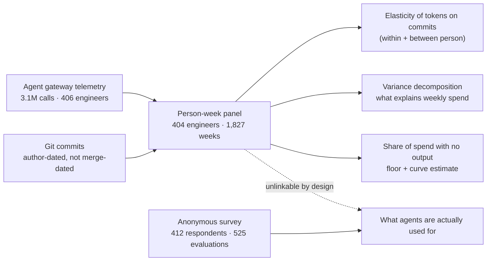
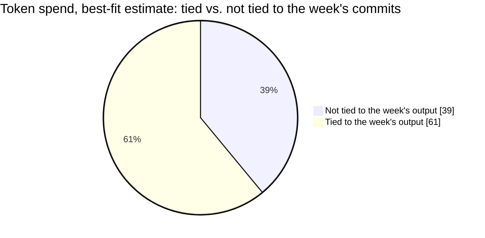
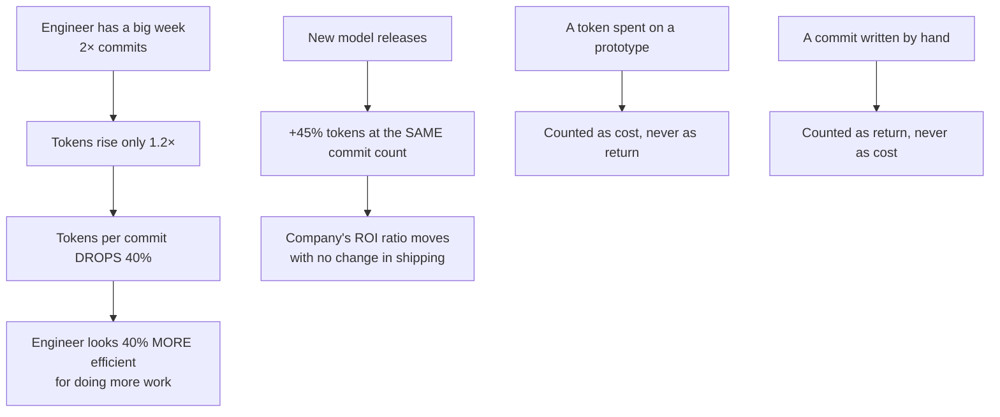
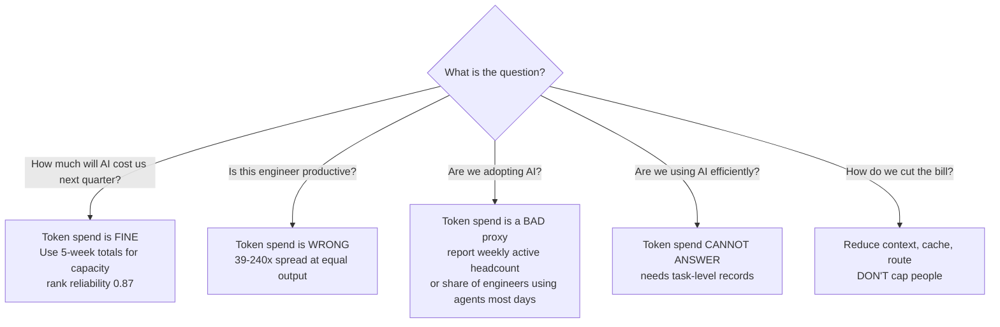

import { Image } from 'astro:assets';

import increasedTokenSpendImage from '../../assets/blog/increased-token-spend-illustration.png';
import tokenFunnelImage from '../../assets/blog/token-funnel-illustration.png';
import tokenVsCommitImage from '../../assets/blog/token-vs-commit-illustration.png';
import tokenSpendVsOutputImage from '../../assets/blog/token-spend-vs-output-illustration.png';
import tokenWrongMeasureImage from '../../assets/blog/token-wrong-measure-illustration.png';
import diverseTokenSpendImage from '../../assets/blog/diverse-token-spend-illustration.png';
import tokenSpreadImage from '../../assets/blog/token-spread-illustration.png';
import tokenPerPrIllustration from '../../assets/blog/token-per-pr-illlustration.png';
import goodhartIllustration from '../../assets/blog/toke-spend-goodhart-illustration.png';
import tokenUsageMetricTrashedIllustration from '../../assets/blog/token-usage-metric-trashed-illustration.png'

> **TL;DR**: Researchers linked five weeks of metered token telemetry to the commit activity of 404 engineers at JetBrains, paired with an internal survey of 412 developers. Doubling an engineer's weekly commits costs approximately 20% more tokens, while doubling token spend corresponds to only ~10% more commits. Up to 39% of token spend does not vary with weekly output, and 89% of surveyed agent tasks involved activities other than direct coding. Token spend measures agent interaction frequency rather than shipped output.

---

## The "how many lines of code did you write?" of 2026

Engineering leadership frequently seeks metrics that are straightforward to collect and appear to track development progress.

For decades, that metric was lines of code (LOC). LOC persisted because software size correlated loosely enough with effort to inform estimation models. Over time, it was adopted as an evaluation target and, following Goodhart's law as Strathern framed it, ceased to provide a meaningful measure of productivity.

Today, organizations increasingly track **token spend**.

Meta introduced and later removed an internal leaderboard ranking engineers by token consumption. Executives at Nvidia and Meta publicly suggested high-performing engineers should consume tokens proportional to substantial fractions of their compensation. Salesforce introduced monthly spending minimums, while Uber consumed its annual 2026 AI developer tool budget within four months, with leadership acknowledging that the link between token spend and delivered functionality remained unproven.

Analytics vendors have begun packaging this into return-on-investment metrics, frequently dividing token volume by merged pull requests.

To evaluate whether token consumption actually reflects engineering productivity, researchers from Carnegie Mellon University and JetBrains analyzed telemetry from professional developers over five weeks.

> **Paper:** *["The AI Era's Lines of Code? A Case Study on What an Engineer's Token Spend Measures,"* Agarwal, Lvova, Sergeyuk, Serova, Bryksin, Zimmermann, Vasilescu. arXiv:2611.13396](https://arxiv.org/abs/2611.13396).

<Image src={increasedTokenSpendImage} alt="Increased Token Spend" style={{marginTop:"1rem",marginBottom:"0.5rem"}} />

---

## The setup: 3.1 million agent calls, 1,827 engineer-weeks

JetBrains runs an internal gateway that meters all coding assistant requests in a uniform schema, standardizing comparison across different models, client interfaces, and caching strategies.

Five weeks of concurrent telemetry (2026-06-29 to 2026-08-02) establish the primary panel dataset: 404 engineers across 1,827 person-weeks, 88% of which record metered agent activity. The median active week recorded 8 commits.

Two analytical considerations apply:
1. The findings reflect observational associations rather than randomized experiments, as developers determined their own tool usage.
2. JetBrains develops commercial software engineering tooling, meaning a portion of internal agent calls reflects internal dogfooding.

<Image src={tokenFunnelImage} alt="Token Funnel" style={{marginTop:"1.0rem",marginBottom:"0.5rem"}} />

---

## Finding #1: Double the commits, get 20% more spend

Fitting a Poisson model with person and week fixed effects (evaluating each engineer's weeks relative to their own baseline), the elasticity of tokens on commits is:

| Estimate | Value | 95% CI |
|---|---|---|
| Tokens on commits (within person) | 0.26 | [0.19, 0.32] |
| Commits on tokens (within person) | 0.13 | [0.03, 0.32] |

This indicates:
- Doubling an engineer's commits corresponds to approximately 20% more tokens (2^0.26 ≈ 1.20).
- Doubling token spend corresponds to approximately 10% more commits (2^0.13 ≈ 1.09).

If spend were proportional to output, as assumed by "tokens per merged PR" metrics, both regression slopes would equal ~1.0. The product of the two slopes is 0.03, rejecting strict proportionality across every tested aggregation interval (p < 0.001).

The researchers tested alternative specifications to evaluate potential confounders:

| Objection | Analytical check | Result |
|---|---|---|
| "Commits are a noisy proxy" | Instrumented commits with lines changed | Slope rises to 0.48, remaining well below 1.0 |
| "Output arrives later than spend" | Day-level cross-correlation across ±10 working days | Output peaks same-day (0.33) and dissipates after ~4 working days |
| "Wrong time unit" | Tested 1 day to 4 weeks | 0.30 (1 day), 0.21 (2 weeks) |
| "Wrong output metric" | Evaluated lines changed and commit-days | Elasticity is 0.19 for lines, 0.40 for commit-days |
| "Heavy-spend weeks write larger commits" | Controlled for commit size, platform share, issue links | No statistically significant effect (p < 0.05) |

Between engineers, the cross-sectional slope is 0.38. Engineers consuming 2× as many tokens average approximately 8% more commits. A tenfold increase in spend correlates with roughly 30% more output across engineers and 35% within an individual engineer's history [7%, 109%].

Prior industry observations show a similar pattern: [Jellyfish usage analysis](https://jellyfish.co/blog/is-tokenmaxxing-cost-effective-new-data-from-jellyfish-explains/) identified that ~10× spend yielded ~40% more output, vendor summaries indicated 10× spend for 2× output, and enterprise field studies by He et al. documented 2.09× throughput at ≥20× token spend.

<Image src={tokenVsCommitImage} alt="Token vs Commit" style={{marginTop:"1.0rem",marginBottom:"0.5rem"}} />

---

## Finding #2: Same output, 39–240× different spend

If spend tracked output, engineers shipping identical commit counts would generate similar token consumption. Instead, within every quintile of weekly commit counts, the 90th percentile of token spend was 39 to 240 times that of the 10th percentile. Even after controlling for all four developer activity metrics, the 90th-percentile person-week consumed 58× the tokens of the 10th percentile.

Over the full five-week observation window, the engineer at the 90th percentile of spend consumed 71× the tokens of the engineer at the 10th percentile.

This disparity occurs because tokens measure context exchange rather than completed work units. In this dataset, the median agent call transmits roughly 400 times as many input tokens as it receives in output tokens. Billed usage primarily reflects re-sending conversation history, file contents, terminal logs, and tool schemas on every interaction turn.

<Image src={tokenSpendVsOutputImage} alt="Token Spend vs Output" style={{marginTop:"1.0rem",marginBottom:"0.5rem"}} />

---

## Finding #3: Individual habits drive spend rather than productivity

| Predictor set | Share of between-person variance explained (held-out) | Share of within-person variance explained (held-out) |
|---|---|---|
| Commits, lines changed, bug-linked commits, commit-days | 38% | 13% |
| Commits + lines changed alone | 38% | — |
| Add issue-tracker activity | +0 pts | — |
| Add pre-period work mix | +3 pts | — |
| Role + manager flag + team | −6% | — |
| Individual identity (in-sample) | 79% | — |

Individual identity explains 79% of the in-sample variance in weekly token spend. Conversely, organizational factors including job title, team, and manager status have negative explanatory power (−6%) when applied to held-out engineers.

High-volume spenders remain high-volume spenders consistently over time. The split-half rank correlation for spend is 0.77, projecting to 0.87 across the full five weeks, matching the longitudinal stability of commit counts (0.87). Engineers who registered the highest consumption in week 0 were largely the same individuals in week 4.

Reliability does not equate to validity. A metric can be statistically stable while capturing the wrong variable. Token spend reliably measures how frequently an engineer interacts with coding assistants, which assists infrastructure capacity planning rather than engineering evaluation.

By contrast, tokens per commit is unstable at the top decile. Of the 34 engineers in the top decile by tokens-per-commit during odd weeks, only 17 remained there during even weeks.

<Image src={tokenWrongMeasureImage} alt="Token Wrong Measure" style={{marginTop:"1.0rem",marginBottom:"0.5rem"}} />

---

## Finding #4: Up to two-fifths of spend never touches a commit

Unlike lines of code, tokens measure an input accumulated regardless of output.

The authors calculated bounds on this untethered consumption through two methods:

- Lower bound (floor): weeks with zero commits accounted for 4% of total token spend (or 3.0% [1.8%, 4.5%] when filtering to above-median-spend weeks).
- Upper bound (curve estimation): a week with zero commits still incurred 77% of that engineer's average weekly token spend. Fitting the curve through spline estimation attributes 39% [31%, 46%] of spend to zero output, while a log(1+x) transformation attributes 42%.

Between 4% and 39% of token spend does not vary with weekly commits. Most of that untethered spend occurs inside weeks that actively produced commits.

The top third of users by volume (accounting for 79% of all tokens) exhibited 36% untethered spend. Team assignment, role, manager status, and historical work mix jointly explained only 11% of that variance.

<Image src={diverseTokenSpendImage} alt="Diverse Token Spend" style={{marginTop:"1.0rem",marginBottom:"0.5rem"}} />

---

## Finding #5: 89% of agent use isn't coding

Agent interactions extend well beyond code synthesis. In the JetBrains internal survey, 184 technical respondents provided 197 evaluations of their usage across two coding assistants:

| Activity | Share of evaluations naming it |
|---|---|
| Coding and development | 63% |
| Processing and analyzing data | 52% |
| Brainstorming / exploring ideas | 49% |
| Research on a topic or project | 44% |
| Planning and structuring work | 39% |
| Learning | 28% |
| Finding/summarizing information | 28% |
| Writing or editing text | 23% |
| Onboarding | 15% |
| Emails, messages, presentations | 8% |

Eighty-nine percent of evaluations reported at least one non-coding activity. Furthermore, reported time savings correlated with activity breadth rather than coding tasks:

- Median reported time saved rose from 3 hours per week for coding-only users to 10 hours for engineers reporting two or more non-coding activities.
- In a regression model of reported hours saved (R² = 0.43), the count of non-coding activity types had a coefficient of 0.24 [0.06, 0.43], while colleagues the work would have otherwise required had a coefficient of 0.43 [0.23, 0.61]. Direct coding use was not statistically significant (0.08 [−0.10, 0.27]).

When asked to describe work enabled by agents, 36% of respondents cited tasks in unfamiliar codebases, languages, or stacks; 25% completed work that would have otherwise been deferred or reassigned; and 23% built prototypes or exploratory experiments. Only one of 44 respondents indicated the work would have proceeded unaltered at a slower pace.

Among 67 free-text responses detailing friction, 49% cited incorrect, plausible-sounding, or low-quality output as their primary complaint. Tooling friction accounted for 24%, prompt steering and context management accounted for 21%, and verification overhead accounted for 18% ("there is a point where time spent on prompting and reviewing exceeds the time savings").

Beyond direct compute costs, 31% of technical users reported increased cognitive load, and 55% reported reviewing or debugging suspected AI-generated material submitted by peers, costing an average of 1.6 hours per week [1.2, 2.1].

<Image src={tokenSpreadImage} alt="Token Spread" style={{marginTop:"1.0rem",marginBottom:"0.5rem"}} />

---

## Why "tokens per PR" is worse than a useless metric

Vendors divide spend by merged PRs and label the ratio ROI. Four structural factors explain why this metric misleads:

1. The ratio falls as output rises. Because token consumption scales sublinearly (d ≈ 0.26), a week with 2× commits consumes only ~1.2× tokens, causing tokens per commit to drop ~40%. The most productive weeks appear artificially efficient through arithmetic alone.
2. The metric is unstable at the top decile. Only 17 of 34 top-decile engineers in odd weeks remained in the top decile during even weeks. The aggregate rank reliability of 0.80 functions for cohort analysis, but fails for individual evaluations.
3. The calculation assumes all tokens generate commits and all commits originate from tokens. Neither assumption holds: unassisted commits register as cost-free output, while prototypes and research register as pure expense.
4. The ratio shifts when model providers update releases. Weeks evaluated on newly released frontier models logged 45% more tokens at identical commit counts (p = 0.03). The measured metric degrades simply because a newer model was deployed.

Adoption tracking through token thresholds encounters the same distortion. During public debates over enterprise adoption rates, aggregate user counts and high-volume thresholds often reflect opposite ends of a heavily skewed distribution. In the JetBrains dataset, the heaviest third of users accounted for 79% of all tokens. Metrics like weekly active users and headcount above a token threshold can diverge by an order of magnitude based on arbitrary boundary choices, and that boundary moves with every model release.

<Image src={tokenPerPrIllustration} alt="Token Per PR" style={{marginTop:"1.0rem",marginBottom:"0.5rem"}} />

---

## Goodhart's Law and token metrics

Industry attempts to track token consumption show similar patterns:

- Meta launched and subsequently dismantled an internal token leaderboard, notifying engineers that token counts would not inform impact evaluations.
- Amazon shut down an internal leaderboard, describing token volume as a "deeply flawed" metric for team adoption and urging engineers to be selective.
- Uber exhausted its 2026 AI tooling budget in four months.
- Salesforce introduced minimum monthly spending quotas.

When a convenient proxy becomes a target, engineers optimize for the metric, and it loses its informational value. The findings in this study demonstrate that token spend fails to reflect output even in the absence of explicit targets. Without any spending mandates, the ratio between the 90th and 10th percentiles of spend within every commit quintile still spanned 39× to 240×.

Removing leaderboards removes gaming incentives, but does not correct the underlying measurement flaw.

<Image src={goodhartIllustration} alt="Goodhart Illustration" style={{marginTop:"1.0rem",marginBottom:"0.5rem"}} />

---

## What to actually do instead

Token telemetry remains useful for operational budgeting, provided teams match the metric to its intended scope:

1. Use spend for resource accounting at multi-week granularity. Five-week totals rank engineers reliably (projected 0.87), whereas two single weeks correlate at only 0.4 to 0.6. Weekly token counts are statistical noise; quarterly totals serve as budget inputs.

2. Log the task at the gateway. The most effective instrumentation change is recording which issue, ticket, or session prompted each agent call. This allows teams to link spend directly to shipped features, closed issues, or architectural decisions rather than raw commit counts.

3. Measure value beyond code artifacts. Frameworks like SPACE and DORA grow noisy when similar outputs combine varying proportions of automated and human effort. While validated hybrid metrics develop, practical proxies offer better signal: 58% of surveyed engineers reported agents allowed them to complete tasks they would have otherwise abandoned. This indicates new work enabled rather than net value, but provides more context than token volume alone.

4. Reduce costs at the API call level rather than capping individual engineers. Because context tokens are resent on every turn, capping individuals curtails productive and untethered usage indiscriminately. Heavy users (accounting for 79% of tokens) exhibited the lowest proportion of untethered spend (36%). Effective cost reductions focus on context caching, prompt compression, and routing routine tasks to lighter models. Teams should track billed currency rather than token counts: one evaluation found pruning 38.4% of tool output tokens increased billed spend by 6.8% because agents repeatedly retrieved missing context.

5. Avoid publishing tokens-per-commit or tokens-per-PR ratios. Dividing token consumption by merged pull requests produces an artifact of arithmetic rather than an index of engineering productivity.

<Image src={tokenUsageMetricTrashedIllustration} alt="Token Usage Metric Trashed" style={{marginTop:"1.0rem",marginBottom:"0.5rem"}} />

---

## Study limitations

- The dataset reflects five weeks at a single organization. JetBrains develops developer tools, and its engineers work on mature codebases where productivity gains from AI may differ from greenfield projects or consulting environments.
- Participation was voluntary without mandatory usage quotas. Imposing explicit spending targets could alter developer behavior and token consumption patterns.
- Git commits omit substantial engineering contributions, including code reviews, architectural planning, system design, mentoring, and the 89% of agent tasks that do not involve direct code generation.
- The 39% upper-bound estimate includes baseline overhead from initializing agent sessions alongside usage supporting uncommitted exploration.

These constraints do not validate token-based productivity tracking. Rather, they confirm that token consumption measures usage intensity instead of delivered engineering output.

---

## The takeaway

Lines of code measured output and survived for decades because program size loosely tracked effort. Token spend measures an input that accumulates whether or not anything ships, and in this dataset it correlates with output far more weakly than lines of code ever did.

As noted in the paper, token spend functions as "the lines-of-code metric of the AI era: easy to measure, easy to game, and disconnected from actual productivity." The telemetry from 3.1 million calls across 1,827 engineer-weeks and 412 surveyed engineers supports that conclusion.

> **If you would not deploy a lines-of-code leaderboard, do not deploy a token leaderboard.**

Track token spend for capacity budgeting, use gateway telemetry to diagnose workflow bottlenecks, and tie task-level records directly to shipped outcomes rather than counting raw tokens. When asked for per-engineer token counts in planning reviews, share the empirical findings from this study.

---

*Disclosure: I have no affiliation with JetBrains, Carnegie Mellon, or any vendor named. I just think engineering metrics should survive contact with data.*