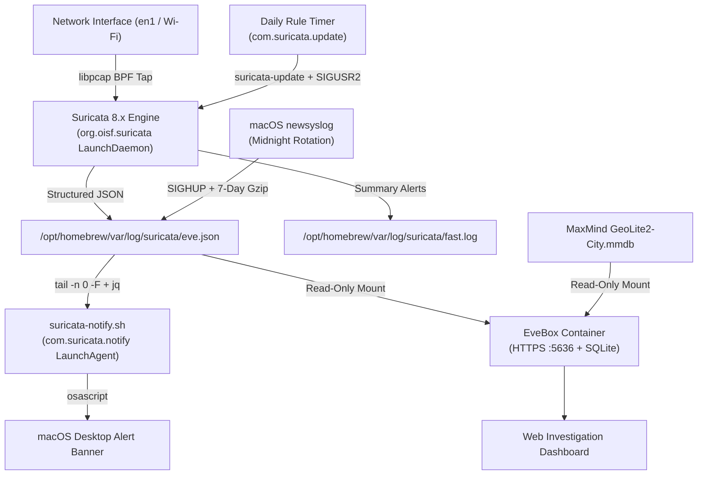
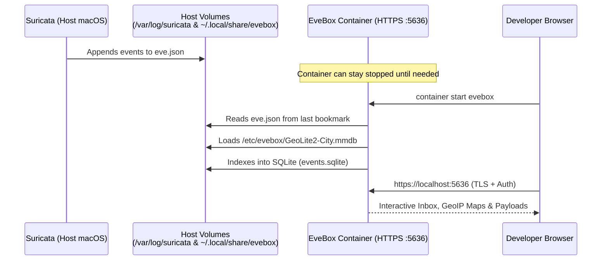

Software teams regularly secure cloud servers, WAFs, and container registries, while local development machines and home lab Macs often operate on flat subnets with little visibility into outbound or lateral network traffic.

While macOS includes endpoint controls like XProtect, Gatekeeper, and System Integrity Protection (SIP), it lacks native deep packet inspection (DPI) and signature-based threat detection. When running third-party package scripts (`npm`, `pip`, `cargo`), local container workloads, webhook receivers, or LAN services, network-level monitoring verifies outbound endpoints and flags traffic matching known exploit or command-and-control (C2) signatures.

This guide covers configuring Suricata 8 IDS on Apple Silicon macOS, managing continuous monitoring and daily rule updates via `launchd`, dispatching native desktop alerts, running EveBox with MaxMind GeoIP enrichment, and comparing Suricata to Sniffnet and LuLu.

---

## 1. What Is an IDS, and Why Run One on a Workstation or Home Lab?

An **Intrusion Detection System (IDS)** is a passive network security sensor that inspects packets crossing a network interface in real time, reassembles TCP/UDP streams, parses application-layer protocols (HTTP, TLS, DNS, QUIC, SMB, SSH), and evaluates traffic against threat-intelligence signatures and protocol anomaly rules.

An IDS operates out-of-band using a packet tap (`libpcap`/BPF on macOS) rather than sitting inline like an Intrusion Prevention System (IPS). This passive model avoids introducing latency into local development workflows while generating structured telemetry in `eve.json`.

### Why a Developer Needs Network-Level Visibility
1. Supply-chain and dependency verification: detecting unexpected outbound connections to newly registered domains, raw IP addresses, or known C2 infrastructure when installing CLI tools, running build scripts, or pulling container images.
2. Protocol and TLS metadata auditing: extracting Server Name Indication (SNI), certificate parameters, ALPN protocols, and JA4 client and server fingerprints even when application payloads are encrypted under TLS 1.3.
3. Local network reconnaissance detection: identifying port scans, lateral movement attempts, rogue DNS queries, or anomalous traffic from IoT devices sharing the local subnet.

---

## 2. System Architecture Overview

The monitoring stack connects the packet tap, rule engine, log rotator, alert daemon, and investigation interface:



---

## 3. Installing Suricata and Finding the Right Network Interface

Homebrew provides native ARM64 builds of Suricata and `jq` (which we will use later for parsing alerts).

### Step 1: Install Dependencies
```bash
brew install suricata jq
```

### Step 2: Identify Your Active Network Interface
On Intel Macs, Wi-Fi was historically `en0`. On modern Apple Silicon Macs (such as the Mac mini M4 or MacBook Pro), `en0` is often Ethernet or Thunderbolt bridge, while Wi-Fi is `en1`. Always verify which interface holds your active LAN IP:

```bash
ipconfig getifaddr en0 || echo "en0 inactive"
ipconfig getifaddr en1 || echo "en1 inactive"
```

Alternatively, list all active interfaces and routes:
```bash
route -n get default | grep interface
```
*(In our setup, `interface: en1` is our active interface.)*

### Step 3: Tune `suricata.yaml` for Deep Packet Inspection (DPI)
Open `/opt/homebrew/etc/suricata/suricata.yaml` and configure three key sections:

1. Define `HOME_NET` to match your local subnet (such as `192.168.1.0/24` or `192.168.0.0/16`).
2. Configure `pid-file` so `newsyslog` and rule reload triggers can signal the active daemon cleanly:
   ```yaml
   pid-file: /opt/homebrew/var/run/suricata.pid
   ```
3. Enable application-layer protocol decoders and extended telemetry logging:
   Under `app-layer.protocols`, enable `tls` (with `ja4-fingerprints: auto`), `http`, `http2`, `quic`, `dns`, `ssh`, and `smb`. Under `stream.reassembly`, set `depth: 10mb` to allow inspection across larger TCP streams. Under `outputs.eve-log`, set `community-id: true`, `payload-printable: yes`, `packet: yes`, `http-body-printable: yes`, and `extended: yes` for HTTP, TLS, and DNS records.

Validate your configuration before starting anything:
```bash
sudo suricata -T -c /opt/homebrew/etc/suricata/suricata.yaml
```
Look for: `Configuration provided was successfully loaded. Exiting.`

---

## 4. Managing Threat Feeds with `suricata-update`

Suricata ships without rules enabled by default. `suricata-update` downloads, merges, deduplicates, and compiles rules into `/opt/homebrew/var/lib/suricata/rules/suricata.rules`.

```bash
# Refresh the remote source index
sudo /opt/homebrew/bin/suricata-update update-sources

# Enable high-signal free feeds (ET Open, OISF Traffic ID, and Abuse.ch feeds)
sudo /opt/homebrew/bin/suricata-update enable-source et/open
sudo /opt/homebrew/bin/suricata-update enable-source oisf/trafficid
sudo /opt/homebrew/bin/suricata-update enable-source abuse.ch/sslbl-blacklist
sudo /opt/homebrew/bin/suricata-update enable-source abuse.ch/sslbl-ja3
sudo /opt/homebrew/bin/suricata-update enable-source abuse.ch/feodotracker
sudo /opt/homebrew/bin/suricata-update enable-source abuse.ch/urlhaus

# Download and compile the ruleset
sudo /opt/homebrew/bin/suricata-update
```

> **Developer Tip:** Avoid legacy `sslbl/ssl-fp-blacklist` or `sslbl/ja3-fingerprints` source names: these deprecated aliases frequently time out. Use the `abuse.ch/*` identifiers shown above.

---

## 5. Automating Suricata & Daily Rule Updates with `launchd`

On macOS, LaunchDaemons in `/Library/LaunchDaemons/` execute as `root` at system boot, run before user login, and automatically restart terminated processes.

### 5.1 Core Suricata Daemon (`org.oisf.suricata.plist`)
The plist configuration includes two operational safeguards:
1. The `-D` (daemonize) flag is omitted so `launchd` supervises the foreground process directly (`KeepAlive: true`).
2. Execution is wrapped in `/bin/sh -c` to remove stale `/opt/homebrew/var/run/suricata.pid` files after unexpected shutdowns, preventing startup crash loops.

```bash
sudo tee /Library/LaunchDaemons/org.oisf.suricata.plist > /dev/null << 'EOF'
<?xml version="1.0" encoding="UTF-8"?>
<!DOCTYPE plist PUBLIC "-//Apple//DTD PLIST 1.0//EN" "http://www.apple.com/DTDs/PropertyList-1.0.dtd">
<plist version="1.0">
<dict>
    <key>Label</key>
    <string>org.oisf.suricata</string>
    <key>ProgramArguments</key>
    <array>
        <string>/bin/sh</string>
        <string>-c</string>
        <string>pgrep -x suricata >/dev/null || rm -f /opt/homebrew/var/run/suricata.pid; exec /opt/homebrew/bin/suricata -c /opt/homebrew/etc/suricata/suricata.yaml --pcap=en1 --pidfile /opt/homebrew/var/run/suricata.pid</string>
    </array>
    <key>RunAtLoad</key>
    <true/>
    <key>KeepAlive</key>
    <true/>
    <key>StandardOutPath</key>
    <string>/opt/homebrew/var/log/suricata/launchd-out.log</string>
    <key>StandardErrorPath</key>
    <string>/opt/homebrew/var/log/suricata/launchd-err.log</string>
</dict>
</plist>
EOF

sudo chown root:wheel /Library/LaunchDaemons/org.oisf.suricata.plist
sudo chmod 644 /Library/LaunchDaemons/org.oisf.suricata.plist
sudo launchctl bootstrap system /Library/LaunchDaemons/org.oisf.suricata.plist
```

### 5.2 Daily Rule Update Script & Timer (`com.suricata.update.plist`)
Suricata supports **zero-downtime live rule reloads** when sent `SIGUSR2`. Create an update wrapper script:

```bash
sudo tee /usr/local/bin/suricata-daily-update.sh > /dev/null << 'EOF'
#!/bin/bash
set -euo pipefail

/opt/homebrew/bin/suricata-update

SURICATA_PID=$(pgrep -x suricata || true)
if [ -n "$SURICATA_PID" ]; then
    kill -USR2 "$SURICATA_PID"
fi
EOF

sudo chown root:wheel /usr/local/bin/suricata-daily-update.sh
sudo chmod 755 /usr/local/bin/suricata-daily-update.sh
```

Schedule it daily at `03:15` via `launchd` (if your Mac is asleep at 03:15, macOS automatically runs the missed job upon wake):

```bash
sudo tee /Library/LaunchDaemons/com.suricata.update.plist > /dev/null << 'EOF'
<?xml version="1.0" encoding="UTF-8"?>
<!DOCTYPE plist PUBLIC "-//Apple//DTD PLIST 1.0//EN" "http://www.apple.com/DTDs/PropertyList-1.0.dtd">
<plist version="1.0">
<dict>
    <key>Label</key>
    <string>com.suricata.update</string>
    <key>ProgramArguments</key>
    <array>
        <string>/usr/local/bin/suricata-daily-update.sh</string>
    </array>
    <key>StartCalendarInterval</key>
    <dict>
        <key>Hour</key>
        <integer>3</integer>
        <key>Minute</key>
        <integer>15</integer>
    </dict>
    <key>StandardOutPath</key>
    <string>/opt/homebrew/var/log/suricata/update.log</string>
    <key>StandardErrorPath</key>
    <string>/opt/homebrew/var/log/suricata/update-err.log</string>
</dict>
</plist>
EOF

sudo chown root:wheel /Library/LaunchDaemons/com.suricata.update.plist
sudo chmod 644 /Library/LaunchDaemons/com.suricata.update.plist
sudo launchctl bootstrap system /Library/LaunchDaemons/com.suricata.update.plist
```

### 5.3 7-Day Log Rotation with `newsyslog`
With extended DPI logging active, `eve.json` can grow quickly. Configure macOS's native `newsyslog` to rotate logs at midnight (`$D0`), compress them with `gzip` (`J`), keep 7 rotated archives, and send `SIGHUP` (`1`) to Suricata so it reopens fresh log descriptors:

```bash
sudo tee /etc/newsyslog.d/suricata.conf > /dev/null << 'EOF'
# logfilename                                     [owner:group] mode count size when  flags [/pid_file] [sig_num]
/opt/homebrew/var/log/suricata/eve.json           root:wheel    640  7     *    $D0   GJ    /opt/homebrew/var/run/suricata.pid  1
/opt/homebrew/var/log/suricata/fast.log           root:wheel    640  7     *    $D0   GJ    /opt/homebrew/var/run/suricata.pid  1
/opt/homebrew/var/log/suricata/suricata.log       root:wheel    640  7     *    $D0   GJ    /opt/homebrew/var/run/suricata.pid  1
/opt/homebrew/var/log/suricata/stats.log          root:wheel    640  7     *    $D0   GJ    /opt/homebrew/var/run/suricata.pid  1
EOF
```

---

## 6. Real-Time macOS Desktop Alerts (`suricata-notify.sh`)

To surface alerts immediately, a notification watcher tails `eve.json` using `tail -n 0 -F` (tracking file inodes across `newsyslog` rotations) and parses alert objects with `jq` to display macOS notifications for High (Severity 1) and Medium (Severity 2) events.

```bash
sudo tee /usr/local/bin/suricata-notify.sh > /dev/null << 'EOF'
#!/bin/bash
EVE_LOG="/opt/homebrew/var/log/suricata/eve.json"
PATH="/opt/homebrew/bin:/usr/bin:/bin:/usr/sbin:/sbin"

tail -n 0 -F "$EVE_LOG" | while IFS= read -r line; do
    if echo "$line" | grep -q '"event_type":"alert"'; then
        SIG=$(echo "$line" | jq -r '.alert.signature // "Unknown Alert"')
        SEV=$(echo "$line" | jq -r '.alert.severity // 3')
        SRC=$(echo "$line" | jq -r '.src_ip // "?"')
        DEST=$(echo "$line" | jq -r '.dest_ip // "?"')

        if [ "$SEV" -le 2 ]; then
            osascript -e "display notification \"$SRC -> $DEST (Severity $SEV)\" with title \"Suricata IDS Alert\" subtitle \"$SIG\" sound name \"Ping\""
        fi
    fi
done
EOF

sudo chown root:wheel /usr/local/bin/suricata-notify.sh
sudo chmod 755 /usr/local/bin/suricata-notify.sh
```

Because GUI notifications must run inside your logged-in desktop session, register it as a user **LaunchAgent**:

```bash
mkdir -p ~/Library/LaunchAgents
cat << 'EOF' > ~/Library/LaunchAgents/com.suricata.notify.plist
<?xml version="1.0" encoding="UTF-8"?>
<!DOCTYPE plist PUBLIC "-//Apple//DTD PLIST 1.0//EN" "http://www.apple.com/DTDs/PropertyList-1.0.dtd">
<plist version="1.0">
<dict>
    <key>Label</key>
    <string>com.suricata.notify</string>
    <key>ProgramArguments</key>
    <array>
        <string>/usr/local/bin/suricata-notify.sh</string>
    </array>
    <key>RunAtLoad</key>
    <true/>
    <key>KeepAlive</key>
    <true/>
</dict>
</plist>
EOF

launchctl bootstrap gui/$(id -u) ~/Library/LaunchAgents/com.suricata.notify.plist
```

---

## 7. Testing & Validating Your IDS Rules

Validating the detection pipeline requires generating benign requests that trigger known signatures.

### Test 1: Malicious User-Agent Signature (`BlackSun`)
```bash
curl -A "BlackSun" http://testmynids.org/uid/index.html
```
* **Triggers:** `ET USER_AGENTS Suspicious User Agent (BlackSun)`

### Test 2: Simulated Linux `uid=0(root)` Command Execution Output
`testmynids.org` hosts a harmless static text string (`uid=0(root) gid=0(root) groups=0(root)`) used across SOC labs to test inbound HTTP response body inspection:
```bash
curl -s http://testmynids.org/uid/index.html
```
* **Triggers:** `GPL ATTACK_RESPONSE id check returned root` (validates that Suricata is reassembling HTTP response bodies, not just outbound headers).

### Test 3: Suspicious `curl` / `Wget` Plain-HTTP Executable Download Pattern
```bash
curl -A "Wget/1.21.1" http://example.com/setup.sh
```
* **Triggers:** Emerging Threats policy/hunting signatures flagging raw shell script downloads over unencrypted HTTP.

### Test 4: Nmap Aggressive / OS-Fingerprint Probe on Local Subnet
If you have a second lab machine or router on your LAN (`<target_ip>`), run a service/version scan from your Mac:
```bash
nmap -sV -A -T4 <target_ip>
```
* **Triggers:** `ET SCAN Nmap Scripting Engine User-Agent` and TCP/SYN reconnaissance alerts.

### How to Validate the Alerts
1. Inspect `fast.log` for summary alert records:
   ```bash
   tail -n 10 /opt/homebrew/var/log/suricata/fast.log
   ```
2. Review structured DPI metadata in `eve.json`:
   ```bash
   grep '"event_type":"alert"' /opt/homebrew/var/log/suricata/eve.json | tail -n 1 | jq .
   ```
   Verify that `alert.signature`, `src_ip`, `dest_ip`, `http`, `payload_printable`, and `community_id` are populated.
3. Confirm desktop notifications: a notification banner should display in the upper-right corner for Severity 1 and 2 events.

---

## 8. Visualizing Alerts with EveBox & MaxMind GeoIP

While `jq` works well for script automation, investigating multi-event sequences is more effective in EveBox, a Rust-based web management console designed for Suricata.



### Step 1: Prepare Persistent Storage & GeoIP Database
1. Create a persistent host folder for EveBox's SQLite database, auto-generated TLS certificates, and user accounts:
   ```bash
   mkdir -p "$HOME/.local/share/evebox"
   ```
2. Download `GeoLite2-City.mmdb` (free with a MaxMind GeoLite2 account) and place it at:
   ```bash
   cp /path/to/GeoLite2-City.mmdb "$HOME/.local/share/evebox/GeoLite2-City.mmdb"
   ```

### Step 2: Create & Run the EveBox Container
EveBox 0.31 and later enables TLS, authentication, and GeoIP lookup by default, automatically reading `/etc/evebox/GeoLite2-City.mmdb` inside the container image. Run the container using Apple's native `container` CLI (or `docker` with identical `-v` and `-p` flags):

```bash
container create \
  --name evebox \
  -v "/opt/homebrew/var/log/suricata:/var/log/suricata:ro" \
  -v "$HOME/.local/share/evebox:/var/lib/evebox" \
  -v "$HOME/.local/share/evebox/GeoLite2-City.mmdb:/etc/evebox/GeoLite2-City.mmdb:ro" \
  -p 5636:5636 \
  docker.io/jasonish/evebox:latest \
  evebox server --host 0.0.0.0 --sqlite \
  -D /var/lib/evebox /var/log/suricata/eve.json

container start evebox
```

### Step 3: Retrieve Auto-Generated Credentials & Sign In
On first launch, EveBox generates an administrator password and prints it in the container logs:
```bash
container logs evebox
```
Look for:
```text
INFO evebox::geoip: Loaded GeoIP database: /etc/evebox/GeoLite2-City.mmdb
WARN evebox::server::main: Created administrator username and password: username=admin, password=<GENERATED_PASSWORD>
INFO evebox::server::main: Starting server on 0.0.0.0:5636, tls=true
```
Open **`https://localhost:5636`**, accept the self-signed certificate prompt, and log in. Because EveBox bookmarks its read offset in `eve.json`, you can keep the container **stopped** (`container stop evebox`) during normal work and start it when investigating alerts. It will process all events captured while offline.

---

## 9. Suricata vs. Sniffnet vs. LuLu: Choosing the Right macOS Network Tools

A common question among developers securing macOS is how **Suricata** differs from popular native macOS tools like **Sniffnet** and **LuLu**. In practice, they solve three completely different layers of network security and work best together:

| Feature / Dimension | **Suricata (+ EveBox)** | **Sniffnet** | **LuLu (Objective-See)** |
| :--- | :--- | :--- | :--- |
| **Primary Role** | Signature and anomaly IDS (Threat detection and DPI) | Real-time traffic visualizer and flow monitor | Outbound application firewall (Process gatekeeper) |
| **Mechanism** | Passive `libpcap` tap + 50,000+ threat-intel rules & protocol parsers | Passive `libpcap` tap + Rust GUI for live bandwidth/flow inspection | Inline macOS Network Extension intercepting outbound sockets |
| **Can It Block Traffic?** | No (passive detection on macOS; requires pairing with `pfctl` for blocking) | No (purely observational monitoring) | **Yes**: blocks or allows outbound connections per binary or endpoint |
| **Process Attribution** | **No**: inspects IPs, ports, SNI, and payloads without mapping to host process names | Limited to socket, host, and port metadata | **Yes**: identifies the exact executable path (`curl`, `python3`, etc.) |
| **Threat Intelligence** | **Comprehensive**: detects exploits, malware C2, JA3/JA4 hashes, and malicious payloads | **None**: displays traffic destinations without threat scoring | **Reputational lookup**: blocks unapproved binaries pending user verification or VirusTotal lookup |
| **Best Use Case** | Continuous background threat detection, forensic logging, and home lab IDS | Visual checks of live bandwidth, protocol mix, and remote hosts | Preventing unauthorized binaries, telemetry, or scripts from communicating outbound |

### Tool Comparison
- Suricata provides payload and signature inspection across network streams. Neither Sniffnet nor LuLu evaluates packet bodies against threat intelligence feeds. Suricata identifies protocol violations, malicious User-Agents, and command-and-control signatures even when generated by an approved host binary such as `curl` or a web browser.
- LuLu provides process attribution and outbound enforcement. Because Suricata operates passively through `libpcap`, it cannot associate network packets with local processes or prevent connections before transmission. LuLu intercepts outbound socket initialization at the operating system level, allowing per-binary enforcement and global connection blocking.
- Sniffnet provides immediate flow inspection. For diagnosing sudden bandwidth spikes or identifying remote hosts in real time without querying SQLite or parsing log files, Sniffnet visualizes active throughput and connection counts directly.

### Recommended Multi-Layer Security Architecture
An effective workstation security configuration combines these complementary layers:
- Run Suricata in the background via `launchd` for continuous anomaly detection, protocol parsing, and log collection.
- Use LuLu at the application layer to regulate which binaries can open outbound network sockets.
- Keep EveBox available on demand to review alert history, inspect payload details, and analyze GeoIP metadata when investigations arise.