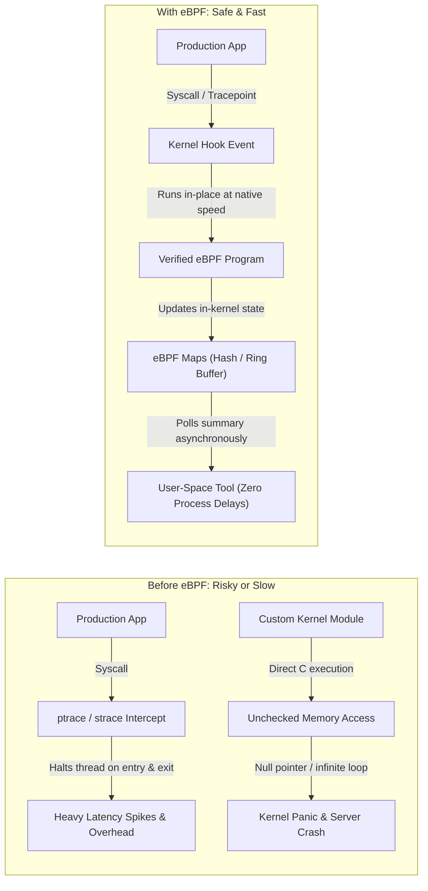
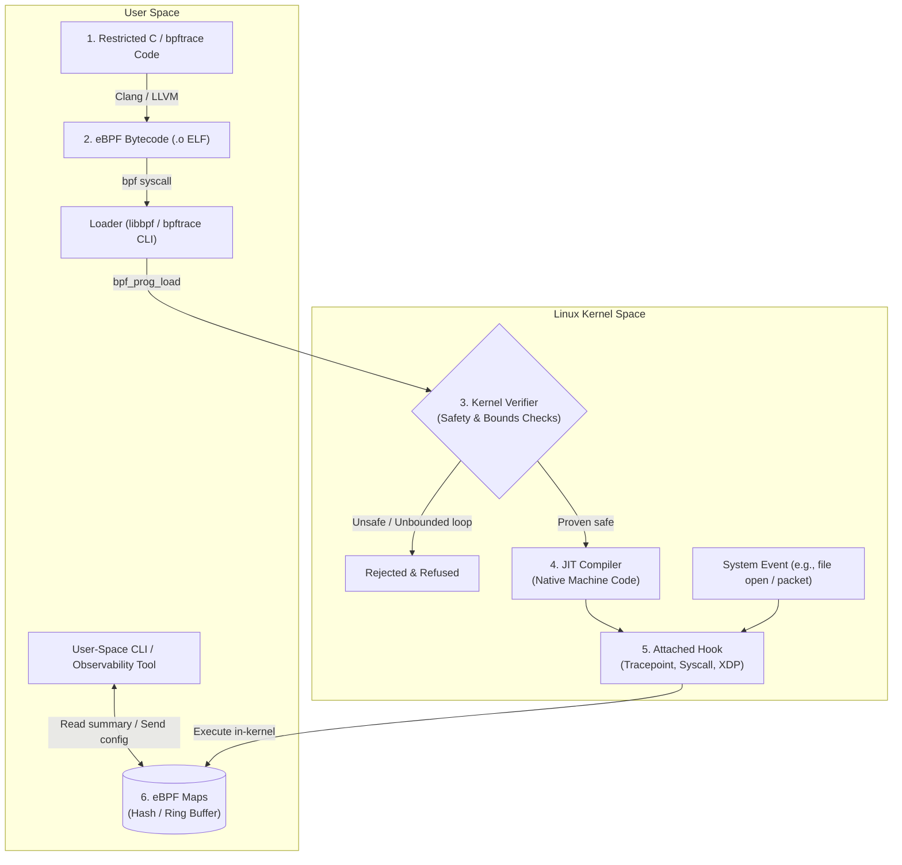
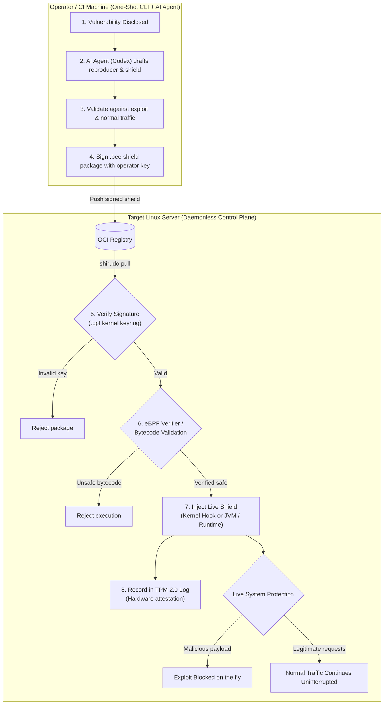

# What is eBPF? How Linux & Shirudo Defend Live Systems

For a long time, I avoided [**eBPF**](https://ebpf.io/) because the name sounded like a dusty 1990s networking textbook. Whenever someone mentioned "Extended Berkeley Packet Filter" in a Kubernetes or security thread, it seemed like low-level packet math that application developers would rarely touch.

Over the past few years, the acronym became unavoidable: [Cilium](https://cilium.io/) for container networking, [Falco](https://falco.org/) and [Tetragon](https://tetragon.io/) for intrusion detection, [Parca](https://www.parca.dev/) for continuous CPU profiling, and recently [**Shirudo**](https://github.com/shirudo-dev/shirudo), an open-source Linux runtime announced by [OpenAI](https://openai.com/index/introducing-shirudo/) and [Cisco](https://newsroom.cisco.com/c/r/newsroom/en/us/a/y2026/m11/cisco-and-openai-launch-shirudo-a-new-project-to-safeguard-agentic-ai.html) in November 2026 that uses AI agents to shield unpatched servers without restarting them.

Examining how eBPF works reveals a straightforward and practical architecture.

> **TL;DR:** [**eBPF**](https://ebpf.io/) lets you run tiny, sandboxed programs inside the Linux kernel safely and at near-native speed, without changing kernel source code or rebooting. Tools like [Cilium](https://cilium.io/) and [bpftrace](https://github.com/bpftrace/bpftrace) use it for networking, observability, and security. OpenAI and Cisco's [**Shirudo**](https://github.com/shirudo-dev/shirudo) builds on that foundation, allowing AI agents and operators to generate cryptographically signed eBPF and runtime "shields" that block zero-day exploits on live Linux systems while permanent patches are rolled out.

---

## Life Before eBPF (And Why It Hurt)

Linux splits system memory and privilege into two distinct spaces:

- **User space:** Where applications run: Node.js servers, Python scripts, PostgreSQL, Nginx, and CLI tools. If a user-space program crashes, Linux terminates that process and the rest of the system remains unaffected.
- **Kernel space:** The privileged core of the operating system. The kernel controls the CPU, memory, disks, and network interfaces, and enforces permissions. When an application needs to open a file or send a network packet, it requests the kernel via a **syscall** (system call).

Before eBPF, gaining deep visibility or custom packet handling in the kernel forced a choice between slow user-space tools and risky kernel modifications.

### The Pain Points of Legacy Tools

- **Kernel modules:** Developers wrote custom C code loaded directly into the kernel. A single null-pointer dereference or infinite loop triggers a kernel panic, crashing the entire machine. In addition, modules regularly break when upgrading kernel versions.
- **`strace` and `ptrace`:** Useful for local debugging, but impractical under heavy production load. `strace` intercepts syscalls by pausing the target thread twice on every single syscall (at entry and exit) to copy arguments into user space.
- **`iptables` and `tcpdump`:** Standard `iptables` evaluates firewall rules sequentially as long lists, degrading throughput in large Kubernetes clusters with thousands of endpoints. `tcpdump` copies raw packet buffers into user space, introducing substantial CPU overhead under sustained traffic.
- **Classic `kprobes`:** Dynamic kernel probes allowed attaching handlers to kernel functions, but lacking a formal safety sandbox, an errant handler could destabilize the entire operating system.

### Example: The `strace` Production Trap

Suppose a production Go API stalls intermittently while reading configuration files. Attaching `strace -p <pid>` to inspect `openat` and `read` syscalls during peak traffic causes `ptrace` to pause the API thread on every file and socket operation. Latency spikes immediately, and throughput can collapse, turning a routine debugging effort into an outage.



*Figure 1: Legacy tracing and kernel modules vs verified in-kernel eBPF execution.*

---

## What Is eBPF?

**eBPF is a sandboxed virtual machine built directly into the Linux kernel.** It attaches small, event-driven programs to specific hooks inside the operating system without modifying kernel source code or rebooting.

A common analogy compares eBPF to JavaScript in web browsers: before JavaScript, browsers rendered static documents, and adding interactive client behavior required vendor updates. JavaScript allowed developers to execute code in response to browser events like clicks. Similarly, eBPF runs sandboxed code inside the Linux kernel in response to system events like packets arriving or files opening.

> **Note:** Technically, eBPF stands for *Extended Berkeley Packet Filter*, named after a 1992 packet-filtering mechanism. Today, eBPF does far more than filter packets, so the community treats "eBPF" as a standalone name rather than an acronym.

### Core Building Blocks of eBPF

Six components define how eBPF operates:

1. **Programs:** Small pieces of logic (usually written in a restricted subset of C or Rust) compiled into eBPF bytecode. Because they are event-driven, they sit idle until a specific hook triggers them.
2. **Hooks:** The attachment points where eBPF programs run. Common hooks include **syscalls** (`openat`, `execve`), **tracepoints** (stable event markers built into the kernel), **kprobes** (dynamic probes on almost any kernel function), **uprobes** (probes on user-space application functions), and **network interfaces** (like XDP, which inspects packets the instant they hit the network driver).
3. **The Verifier:** The static safety analyzer. Before an eBPF program loads, the verifier evaluates every execution path. It rejects code that attempts to dereference null pointers, access out-of-bounds memory, loop indefinitely, or exceed instruction limits. If the verifier cannot prove safety and termination across all paths, loading fails.
4. **JIT (Just-In-Time) Compiler:** After verification, the JIT compiler translates bytecode into native CPU instructions (x86-64, ARM64, or RISC-V), allowing eBPF programs to execute at native processor speed without interpreter overhead.
5. **Maps:** Shared key-value data structures (hash tables, arrays, ring buffers, LRU caches) that live in kernel memory. Maps let eBPF programs store state between events and share aggregated data cleanly with user-space dashboards or CLI tools.
6. **Helpers (and `kfuncs`):** Because eBPF programs are sandboxed, they cannot call arbitrary kernel functions directly. Instead, the kernel exposes a curated standard library of helper functions for reading process identifiers, getting timestamps, or updating maps.

### Example: Counting File Opens Without Flooding User Space

To monitor which process opens the most files on a busy server without streaming millions of raw file-open events to user space, you can attach an eBPF program to the `sys_enter_openat` tracepoint. Each time a process opens a file, the program increments a counter keyed by Process ID (PID) inside an **eBPF hash map**. A user-space CLI reads that summary table periodically, moving kilobytes of data rather than gigabytes.

---

## How eBPF Works Under the Hood

Deploying and executing an eBPF program follows a six-step pipeline:

1. **Write & Compile:** You write an eBPF program in restricted C (or a high-level language like `bpftrace`) and compile it with **Clang/LLVM** into platform-independent eBPF bytecode (`.o` ELF object file).
2. **Load via `bpf()` Syscall:** A user-space loader (such as `libbpf` or `bpftrace`) calls the `bpf()` syscall to submit the bytecode to the kernel.
3. **Static Verification:** The **eBPF verifier** walks the bytecode's control-flow graph, checking register states, pointer bounds, memory access safety, and loop termination.
4. **JIT Compilation:** The **JIT compiler** converts the verified bytecode into native CPU instructions.
5. **Attach to Hook:** The loader attaches the compiled program to a chosen hook (for example, a syscall tracepoint or network socket).
6. **Execute & Share via Maps:** Every time the kernel hits that hook, your eBPF program runs, updates an **eBPF map** or ring buffer, and user space reads the result.



*Figure 2: The eBPF lifecycle from user-space C code to verified in-kernel execution and map telemetry.*

---

## Four Problems eBPF Solves

eBPF addresses four historical constraints in Linux infrastructure:

* **Safety without trust:** Unlike kernel modules, eBPF programs cannot crash the kernel. If code contains an out-of-bounds array read, the verifier blocks it at load time before any instructions run.
* **High performance:** Because eBPF runs in place inside the kernel and aggregates metrics in maps, it avoids frequent context switches between kernel and user space. Cloudflare uses eBPF at the XDP (eXpress Data Path) layer to drop millions of DDoS packets per second before the kernel allocates socket buffers.
* **Zero reboots or downtime:** You can load, update, and detach programs on live production instances in milliseconds without dropping active TCP connections.
* **Portability without host compilers:** With **CO-RE** (*Compile Once, Run Everywhere*) and **BTF** (*BPF Type Format*), developers compile an eBPF binary once and run it across different Linux distributions and kernel versions without shipping compilers to production hosts.

---

## Common Production Use Cases

eBPF forms the core of several cloud-native networking, observability, and security tools:

### 1. Networking: Cilium

Standard Kubernetes networking relies on `iptables` rules that degrade as cluster sizes grow. [**Cilium**](https://cilium.io/) handles packet routing with eBPF programs attached to network sockets and interfaces. Cilium routes traffic directly between container pods via hash table lookups, reducing network latency and enforcing Layer 7 (HTTP/gRPC) network policies based on workload identity rather than IP addresses.

### 2. Observability & Profiling: Pixie and Parca

Standard APM agents often require modifying application source or running sidecars. [**Pixie**](https://px.dev/) uses eBPF uprobes and kprobes to capture HTTP, gRPC, and database queries cluster-wide with no application changes. [**Parca**](https://www.parca.dev/) uses eBPF to sample CPU stack traces across active processes with low overhead (typically around 1% CPU), identifying memory allocations and execution hot spots in production without recompilation.

### 3. Runtime Security: Falco and Tetragon

Image scanners check container filesystems before deployment, leaving runtime execution unmonitored. [**Falco**](https://falco.org/) uses an eBPF driver to stream syscall events and alert on suspicious behavior, such as a container spawning `/bin/sh`. [**Tetragon**](https://tetragon.io/) (developed by [Isovalent](https://isovalent.com/), now part of Cisco) enforces security policies synchronously in kernel space: if an exploit attempts to read `/etc/shadow` or open an unauthorized outbound connection, Tetragon blocks the syscall or terminates the process immediately.

---

## Hands-On: Tracing Kernel Events with `bpftrace`

[**`bpftrace`**](https://github.com/bpftrace/bpftrace) provides a concise tracing language inspired by `awk` and C, compiling one-line scripts into eBPF programs directly from the terminal.

### Prerequisites

* A Linux machine or VM running **Linux kernel 5.8 or newer** (Ubuntu 22.04+, Fedora, Debian 12+, or similar).
* **Root privileges** (`sudo` or `CAP_BPF` + `CAP_PERFMON` capabilities).
* **`bpftrace` installed** (for example: `sudo apt-get update && sudo apt-get install -y bpftrace` on Debian/Ubuntu, or `sudo dnf install -y bpftrace` on Fedora).

> **Warning:** Run eBPF experiments in a local Linux VM or development container first. While the kernel verifier prevents crashes, tracing high-frequency functions on a heavily loaded production box can still generate noisy terminal output.

### Step 1: Trace Every File Opened on Your System

Run this single command in your terminal:

```bash
sudo bpftrace -e 'tracepoint:syscalls:sys_enter_openat { printf("%-16s (PID %d) opened: %s\n", comm, pid, str(args->filename)); }'

```

Open a second terminal tab and run `ls` or `cat /etc/hostname`. In your first terminal, you will immediately see live kernel telemetry stream by:

```text
Attaching 1 probe...
ls               (PID 4821) opened: /etc/ld.so.cache
ls               (PID 4821) opened: /lib/x86_64-linux-gnu/libc.so.6
ls               (PID 4821) opened: .
cat              (PID 4822) opened: /etc/hostname

```

Press `Ctrl+C` to stop tracing and detach the eBPF program cleanly.

### Line-by-Line Breakdown

* `sudo bpftrace -e '...'`: Launches `bpftrace` and evaluates the inline script, compiling it to eBPF bytecode and loading it via the `bpf()` syscall.
* `tracepoint:syscalls:sys_enter_openat`: The **hook**. Every time *any* program on the system invokes the `openat` syscall to open a file, this eBPF program triggers.
* `comm` and `pid`: Built-in eBPF helper lookups returning the current process command name (`ls`, `cat`) and its Process ID.
* `str(args->filename)`: Safely reads the file path string passed into the `openat` syscall argument using kernel memory-reading helpers verified by the eBPF verifier.

### Step 2: Aggregate Syscall Counts in a Kernel Map

To see **eBPF maps** in action, run this one-liner for five seconds and press `Ctrl+C`:

```bash
sudo bpftrace -e 'tracepoint:raw_syscalls:sys_enter { @[comm] = count(); }'

```

When you hit `Ctrl+C`, `bpftrace` dumps the kernel hash map (`@`) sorted by count:

```text
Attaching 1 probe...
^C

@[node]: 412
@[systemd-journal]: 894
@[sshd]: 1320

```

Notice that nothing was printed while the command ran. The eBPF program incremented counters directly inside a kernel hash map (`@[comm]`) and only copied the final summary table to user space when you exited.

---

## Shirudo: Runtime Defense with Signed Shields

On November 23, 2026, [**OpenAI**](https://openai.com/index/introducing-shirudo/) and [**Cisco**](https://newsroom.cisco.com/c/r/newsroom/en/us/a/y2026/m11/cisco-and-openai-launch-shirudo-a-new-project-to-safeguard-agentic-ai.html), alongside Cisco's [Isovalent team](https://isovalent.com/blog/post/cisco-openai-shirudo/), open-sourced [**Shirudo**](https://github.com/shirudo-dev/shirudo) (Japanese for "shield"). Shirudo is an eBPF-based Linux security runtime designed to protect live systems while permanent software patches are developed and tested.

### The Window Between Disclosure and Patching

When a critical vulnerability is disclosed, testing and rolling software updates across production fleets routinely takes days or weeks. Automated scanning and exploit generation have also accelerated how quickly vulnerabilities are weaponized after disclosure.

During this window, defenders typically have two poor options:

* Leave services exposed while waiting for upstream package updates.
* Block the entire system call or network port, which disrupts legitimate traffic sharing the same operation.

### Shirudo Architecture

Shirudo builds on Isovalent's Tetragon security engine. Instead of requiring human-written YAML rules or restrictive DSLs, it enables automated tools to generate and evaluate defensive mitigations directly as code.

Shirudo relies on four core mechanisms:

1. **In-place mitigation without restarts:** Shirudo deploys temporary protections called **shields** (packaged as signed micropatches, or `upatches`). These intercept vulnerable execution paths or filter invalid input while normal requests continue processing.
2. **Automated shield drafting:** An automated control system (such as OpenAI's **Codex**) analyzes a disclosure, constructs a reproduction harness, drafts a mitigation, and verifies that the patch blocks the exploit without breaking normal traffic. Operators retain signing keys and approve deployments.
3. **Cryptographic verification:** Shields compile into signed `.bee` artifacts stored in standard OCI registries. On target nodes, the kernel validates loader signatures against a sealed `.bpf` keyring, and the eBPF verifier checks program safety before execution.
4. **Hardware measurement:** Target nodes use a **Trusted Platform Module (TPM 2.0)** to log cryptographic measurements when shields are loaded or removed, supporting offline audit and verification via `shirudo attest`.

### Case Study: Mitigating "Java4Shell" on Live Elasticsearch

In their technical walkthrough, OpenAI and Isovalent demonstrated Shirudo against **Java4Shell**, a heap-corruption flaw in OpenJDK's `java.util.Base64$Decoder.decode0` method.

Because the vulnerability exists in JVM execution memory rather than at the system call layer, Codex generated a shield as Java bytecode rather than an eBPF kernel hook. The shield attached an input validation guard directly to `Base64$Decoder.decode0` inside a running **Elasticsearch 9.5.5** process without restarting the application.

Under test, the shield intercepted and dropped the malformed payload:

```text
Base64 guard installed on java.util.Base64$Decoder.decode0 (classfile)
Base64 guard rejected candidate: length=65, padding=1, remainder=1, alphabet=standard
```

Elasticsearch remained online and continued processing normal search queries throughout the test.

---

## How Shirudo Extends eBPF

Shirudo pairs eBPF and runtime bytecode hooks with a signed, daemonless deployment workflow. It avoids persistent background daemons on both build hosts and target nodes: an eBPF program loaded at boot (`shirudo init`) protects runtime state against unauthorized local processes, while one-shot CLI commands pull and verify `.bee` packages from OCI registries.

| Dimension | Traditional Patching & Firewalls | Standard eBPF Security (e.g., Tetragon) | Shirudo (OpenAI + Cisco) |
| --- | --- | --- | --- |
| **Time to mitigate** | Days to weeks (build, test, rolling restart) | Minutes to hours (human writes policy) | Machine speed (AI agent drafts & tests shield; human approves) |
| **Service disruption** | Often requires process restart or OS reboot | Zero downtime; live kernel attachment | Zero downtime; live kernel or runtime injection |
| **Authoring interface** | Upstream source patches or coarse firewall rules | Human-oriented YAML / policy DSLs | Direct eBPF C or runtime bytecode generated by agents or engineers |
| **Trust & anti-tampering** | Package manager signatures (APT/RPM) | Root / `CAP_BPF` privilege check + eBPF verifier | Sealed `.bpf` kernel keyring + eBPF verifier + TPM 2.0 attestation |
| **Runtime footprint** | OS package updates | Persistent user-space daemon on each node | Daemonless one-shot CLI + boot-loaded eBPF control plane |



*Figure 3: Shirudo architecture: from AI shield generation to signed OCI distribution, kernel verification, and live zero-downtime protection.*

---

## Constraints and Limitations

When evaluating eBPF and Shirudo for production infrastructure, five operational constraints apply:

1. **Shirudo is pre-release software:** Production deployment currently requires a Linux kernel carrying Shirudo's signed-loader ABI patches (based on `bpf-next`), `systemd`, a Unified Kernel Image (UKI), and TPM 2.0 hardware. Local testing is possible using a software TPM in a virtual machine.
2. **Linux-specific architecture:** Both technologies rely on Linux kernel internals, LSM hooks, and TPM measurement chains. Neither runs natively on macOS or Windows.
3. **Shields are temporary mitigations:** Runtime shields provide containment while permanent patches are tested. Relying on accumulated runtime shields without updating underlying packages introduces operational technical debt.
4. **Scope limits of kernel hooks:** As the Java4Shell test demonstrated, kernel eBPF hooks cannot easily inspect internal heap memory inside runtimes like the JVM or Python interpreter. Mitigations must target the layer where the vulnerability executes.
5. **Validation requirements:** Shields must be tested against realistic traffic patterns to prevent false positives. Running shields in monitoring mode before enforcing blocks helps avoid unintended service disruption.

---

## Frequently Asked Questions (FAQ)

### What is eBPF in simple terms?

**eBPF** is a built-in Linux kernel technology that lets you run small, sandboxed programs inside the operating system without changing kernel source code or rebooting. Before an eBPF program runs, the kernel's verifier checks it to guarantee it cannot crash the system or get stuck in an infinite loop.

### Is eBPF a replacement for kernel modules?

For most observability, networking, and security tasks, **yes**. eBPF provides near-native performance via JIT compilation while eliminating the kernel-panic risks and version-breakage headaches of traditional C kernel modules. Kernel modules are still used when adding brand-new hardware drivers or core subsystems that eBPF hooks do not expose.

### Does eBPF slow down Linux servers?

Very little when written properly. Because eBPF programs compile to native machine instructions and aggregate metrics inside kernel **maps** instead of copying raw events to user space, production profiling and networking tools typically add **under 1% to 2% CPU overhead**, well below legacy tools like `strace` or `iptables`.

### What is Shirudo and how does it use eBPF?

**Shirudo** is an open-source Linux security runtime introduced by **OpenAI and Cisco** in November 2026. It uses eBPF and cryptographically signed micropatches ("shields") so security teams and automated agents can block active exploit paths on running Linux systems without restarts while permanent software patches are prepared.

### Can I run eBPF or Shirudo on macOS or Windows?

**No**, not natively. eBPF is a Linux kernel subsystem (though Microsoft maintains an experimental `ebpf-for-windows` project for select network hooks). On macOS or Windows, developers run a lightweight Linux virtual machine (using Lima, Multipass, or Docker Desktop) to experiment with `bpftrace` and Shirudo.

---

## Key Takeaways and Next Steps

* **Safe kernel programmability:** A static verifier, JIT compiler, hooks, and maps allow Linux to inspect and modify runtime behavior without downtime or kernel patches.
* **Low-overhead observability:** Unlike `strace` or sequential `iptables` rule lists, eBPF runs in-kernel and aggregates metrics locally in maps before reporting to user space.
* **Ecosystem maturity:** Tools like Cilium, Parca, Falco, and Tetragon use eBPF across Kubernetes networking, continuous profiling, and runtime security.
* **Automated live mitigation:** Shirudo demonstrates how eBPF, signed OCI packages, TPM attestation, and automated patch drafting provide zero-downtime containment for zero-day vulnerabilities.

### Where to Go Next

1. **Spin up a local Ubuntu VM** and run the `bpftrace` file-open one-liner from this guide to see live kernel events firsthand.
2. **Explore Isovalent's hands-on labs** to see how Cilium and Tetragon enforce network and syscall policies in Kubernetes.
3. **Clone [`shirudo-dev/shirudo`](https://github.com/shirudo-dev/shirudo)** and walk through the VM quickstart to inspect how a `.bee` package is signed, verified against a `.bpf` keyring, and measured into a TPM.

---

## References

* [eBPF.io: Official Community Portal](https://ebpf.io/) - Introductory guides, architecture explanations, and the canonical landscape of eBPF projects.
* [Linux Kernel Official BPF Documentation](https://docs.kernel.org/bpf/) - Upstream kernel reference covering the eBPF verifier, maps, helper functions, syscalls, and instruction set.
* [Brendan Gregg's Linux eBPF Tracing Tools](https://www.brendangregg.com/ebpf.html) - Foundational performance engineering tutorials, latency heatmaps, and `bpftrace` / BCC one-liners.
* [bpftrace on GitHub](https://github.com/bpftrace/bpftrace) - High-level tracing language and CLI compiler for ad-hoc Linux kernel and user-space observability.
* [IOVisor BCC (BPF Compiler Collection)](https://github.com/iovisor/bcc) - Toolkit and suite of classic single-purpose eBPF performance utilities like `execsnoop` and `opensnoop`.
* [libbpf on GitHub](https://github.com/libbpf/libbpf) - Standard C/C++ library for loading eBPF programs and building portable CO-RE (*Compile Once, Run Everywhere*) applications.
* [Cilium Official Website](https://cilium.io/) - Cloud-native networking, observability, and security platform powered by eBPF.
* [OpenAI and Cisco Introduce Shirudo (OpenAI Blog)](https://openai.com/index/introducing-shirudo/) - Official launch announcement detailing Shirudo's four core capabilities, TPM verification, and the Java4Shell test.
* [Cisco and OpenAI Introduce Shirudo (Isovalent Engineering Blog)](https://isovalent.com/blog/post/cisco-openai-shirudo/) - Deep technical walkthrough by Thomas Graf and Liz Rice explaining Shirudo's roots in Tetragon, `.bee` packages, and Elasticsearch mitigation logs.
* [Cisco and OpenAI Launch Shirudo (Cisco Newsroom)](https://newsroom.cisco.com/c/r/newsroom/en/us/a/y2026/m11/cisco-and-openai-launch-shirudo-a-new-project-to-safeguard-agentic-ai.html) - Cisco's press release covering the open-source collaboration and self-defending infrastructure vision.
* [shirudo-dev/shirudo on GitHub](https://github.com/shirudo-dev/shirudo) - Open-source BSD-2-Clause repository containing Shirudo's CLI, BPF guards, `upatch` specifications, and VM quickstart.

---